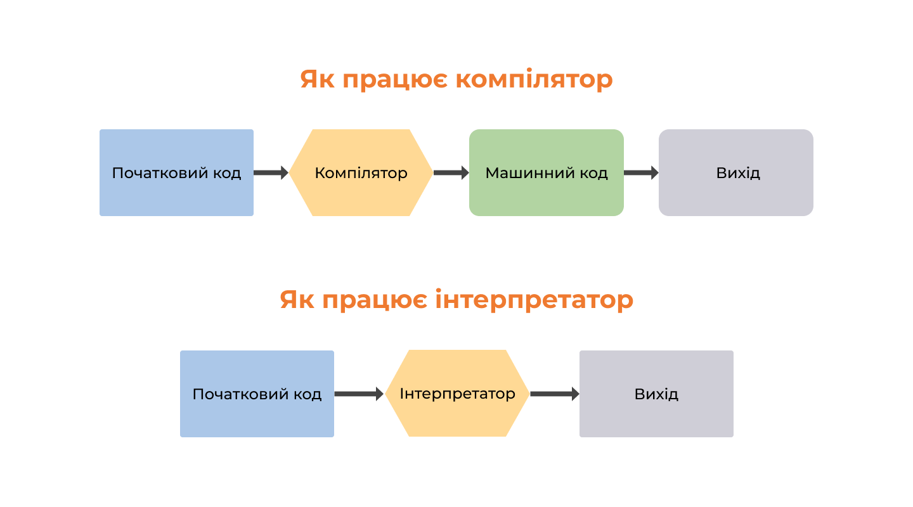
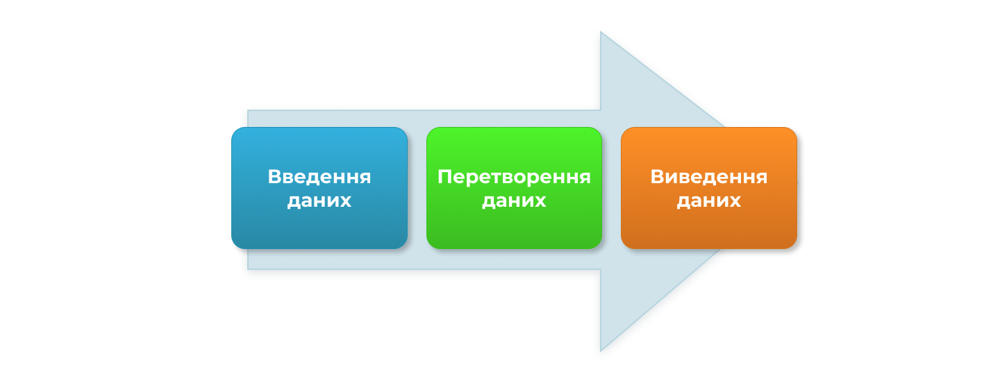
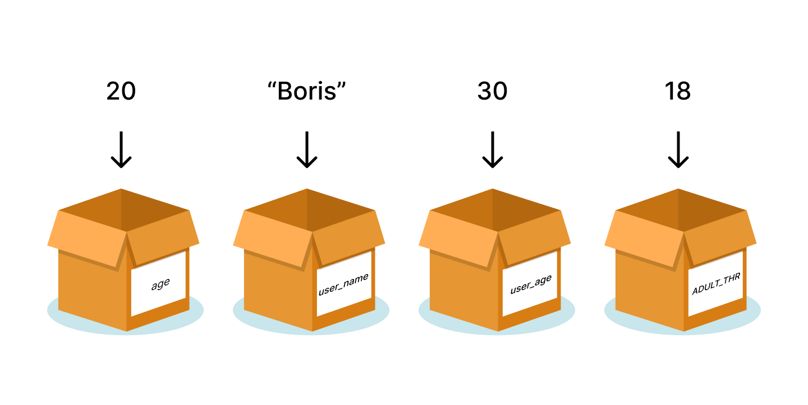
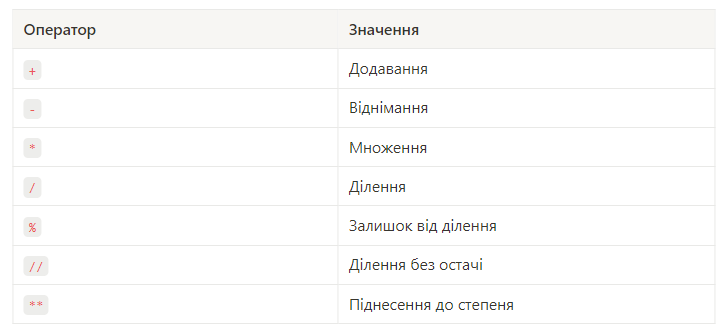
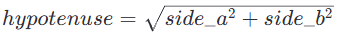
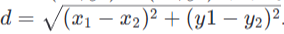

# Синтаксис, змінні, типи даних, оператори

## Початковий код

Коли ми говоримо про програмування, перше, що спадає на думку — це набір інструкцій у файлі або, як кажуть, початковий код.

У прикладі нижче наведено початковий код Python, який під час запуску виведе в консоль текст `"Hello World!"`.

```py
print("Hello World!")
```

**Початковий код (source code)** — це набір фраз, слів і спеціальних символів, специфічних для мови програмування, що описують набір інструкцій для комп'ютера.

Але символи, слова та фрази, які складають програму, насправді не зрозумілі для машини. Є крок, який виконується після написання програми, який конвертує вихідний код у файлі в набір інструкцій, зрозумілих комп'ютеру. Цим займається спеціальна програма: компілятор або інтерпретатор.

Компілятор та інтерпретатор є двома основними типами перекладачів, які використовуються для перетворення написаного коду мовою програмування в машинний код, який може виконувати комп'ютер.

*Компілятор* перетворює весь код програми в машинний код перед її виконанням. Цей процес відомий як компіляція. Після компіляції програма стає виконуваним файлом (`*.exe`), який може бути запущений на комп'ютері. Компіляція відбувається один раз, і після цього програму можна запускати без необхідності повторної компіляції, доки не відбудуться зміни у коді. Мови програмування, які використовують компілятори — це C, C++ і Rust.

*Інтерпретатор* перекладає код програми на машинний код під час її виконання, обробляючи код по рядках. Інтерпретатори не створюють виконуваних файлів; замість цього, вони читають і виконують код безпосередньо. А це означає, що програму потрібно інтерпретувати кожного разу при її запуску. Мови програмування, які використовують інтерпретатори, це Python, Ruby і PHP.



Обидва ці підходи мають свої переваги та недоліки. Компілятори зазвичай забезпечують кращу продуктивність програми та оптимізацію, але процес розробки може бути повільнішим через необхідність повторної компіляції після кожної зміни. Інтерпретатори дозволяють швидше тестувати та розробляти, оскільки зміни можна відразу ж випробовувати, але виконання програми може бути повільнішим порівняно з компільованими програмами.

Ми вивчаємо [**Python**](https://www.python.org/) — це високорівнева *інтерпретована мова програмування* загального призначення з *динамічною типізацією*, стандартна бібліотека якої містить великий набір корисних функцій.

Створений [Гвідо ван Россумом](https://uk.wikipedia.org/wiki/%D0%93%D0%B2%D1%96%D0%B4%D0%BE_%D0%B2%D0%B0%D0%BD_%D0%A0%D0%BE%D1%81%D1%81%D1%83%D0%BC) та вперше випущений у 1991 році, Python заслужив популярність завдяки своїй читабельності та простоті синтаксису, що дозволяє програмістам виражати концепції в меншій кількості коду порівняно з багатьма іншими мовами.

## Основні характеристики Python

Основні характеристики Python включають:

1. **Читабельність і простота**: Python має простий та інтуїтивно зрозумілий синтаксис, який робить його доступним для новачків. Він підтримує як процедурне, так і об'єктно-орієнтоване програмування.
1. **Інтерпретована мова**: Код Python виконується рядок за рядком, що спрощує налагодження та тестування.
1. **Динамічна типізація**: У Python не потрібно заздалегідь оголошувати типи змінних; тип визначається автоматично під час виконання програми.
1. **Універсальність**: Python застосовується в широкому спектрі галузей, від веброзробки до наукових досліджень, від аналізу даних до штучного інтелекту.
1. **Велика стандартна бібліотека**: Python поставляється зі стандартною бібліотекою, яка включає широкий набір інструментів для різних завдань. Фактично це швейцарський ніж для програмування.
1. **Спільнота та підтримка**: Python має одну з найбільших і найактивніших спільнот серед мов програмування, що сприяє поширенню великої кількості ресурсів, бібліотек та інструментів.

Python використовується як в академічних, так в у комерційних цілях, і його популярність продовжує зростати завдяки його гнучкості, простоті вивчення та великій екосистемі.

Сьогодні **Python** використовують у таких сферах:

- **Web-розробка**: За допомогою фреймворків, таких як Django та FastAPI, Python дозволяє створювати масштабовані вебдодатки та API.
- **Data Science**:
    - **Data Mining (отримання даних)**: Аналіз великих даних для отримання корисної інформації та знань.
    - **Machine Learning (машинне навчання)**: Розробка моделей, які можуть навчатися та робити прогнози на основі даних.
    - **Deep Learning (глибинне навчання)**: Створення складних нейронних мереж для розробки систем з високим рівнем інтелекту.
- **Наукові дослідження**: Python широко використовується у фізиці, хімії, біології та інших сферах наукових досліджень для аналізу даних і моделювання.
- **Розробка ігор**: Хоча Python не є основною мовою для розробки великих ігор, він часто використовується для створення прототипів і розробки інструментів для ігор.
- **Інтернет речей (IoT)**: Python використовується для розробки додатків, що забезпечують взаємодію між пристроями та їх керування через Інтернет.
- **Автоматизація**: Легкість написання скриптів на Python робить його популярним вибором для автоматизації рутинних задач.
- **Фінанси і торгівля**: Аналіз фінансових даних, алгоритмічна торгівля, оцінка ризиків та багато іншого.

Ця універсальність Python, його багата екосистема бібліотек та активна спільнота роблять його однією з найпопулярніших мов програмування у світі.

## Елементи програм

Якщо розглядати написання програм спрощено, то в будь-якої програми є:

- **Введення (отримання даних)**: Це етап, на якому програма отримує дані від користувача, файлу, бази даних, інтернету, сенсорів або інших джерел. Ці дані можуть бути в різних форматах, таких як текст, числа, зображення, аудіо тощо.
- **Перетворення (обчислення, обробка даних)**: На цьому етапі програма обробляє отримані дані. Це може включати в себе алгоритми, обчислення, аналіз даних, машинне навчання, логічні операції тощо. Мета цього етапу — перетворити вхідні дані в корисну інформацію або досягти необхідного результату обробки.
- **Виведення даних**: Після обробки даних програма виводить результати. Це може бути у вигляді тексту на екрані, збереження даних у файл, відправлення даних в інтернет, контроль пристроїв тощо. Виведення — це спосіб, у який програма комунікує з користувачем і доносить результати своєї роботи до користувача або інших систем.



Такі елементи повинні бути в будь-якій програмі. Бо без виведення неможливо зрозуміти, що програма виконала, тому її робота залишається невидимою та незрозумілою для користувача. Обчислення — це серце програми, де відбувається основна обробка даних. Без обчислень програма перетворюється на простий інструмент зберігання чи відображення даних без можливості аналізу або обробки, що значно знижує її практичну цінність. І нарешті, якщо немає введення — програма існує в ізоляції, не здатна приймати зовнішні дані та реагувати на них, що обмежує її здатність бути корисною в динамічному середовищі.

Загалом ці три компоненти спільно формують фундамент будь-якої програми, забезпечуючи її здатність до сприйняття, обробки та надання даних, що є основою для її корисності та ефективності.

Розглянемо приклад, який демонструє ці елементи:

```py
# Введення (отримання даних)
ім_я = input("Введіть ваше ім'я: ")

# Перетворення (обробка даних)
вітання = f"Привіт, {ім_я}!"

# Виведення (виведення даних)
print(вітання)
```

Далі користувач вводить своє ім'я, програма створює вітання, а потім виводить його на екран. Якщо користувач вводить ім’я, наприклад, Валерія, в результаті буде виведено:

```bash
Введіть ваше ім'я: Валерія
Привіт, Валерія!
```

## Змінні

Змінна — це ім'я або псевдонім для деякої області пам'яті комп'ютера.

Передбачається, що в цій пам'яті лежить корисна для розробника інформація, до якої існує необхідність звертатися неодноразово під час виконання програми. Тож Python, як і будь-яка інша мова програмування, працює з даними у пам'яті, до яких звертається за допомогою імен (змінних).

Змінні є основними "будівельними блоками" у програмуванні на Python, оскільки вони дозволяють зберігати дані та маніпулювати ними, що є ключовим аспектом більшості програм.

**Змінна** — це елемент пам'яті, у якого є ім'я і в якому можуть зберігатися дані.

```py
age = 20
user_name = "Boris"
user_age = 30
ADULT_THR = 18
```

Коли ви створюєте змінну, ви "резервуєте" певну область у пам'яті, де можна зберігати, змінювати та отримувати дані. У нашому коді вище змінна з ім'ям `age` представляє вік та отримує значення `20`. Іншими словами, змінна `age` тепер вказує на область пам'яті, де зберігається число `20`.

Наступна змінна `user_name` представляє ім'я користувача та отримує значення рядка `"Boris"`. Змінна `user_name` тепер вказує на область пам'яті, де зберігається рядок `"Boris"`. Це як етикетка на коробку, щоб краще розуміти, що в ній зберігається. Подивись на малюнок нижче для кращого розуміння процесу зберігання значень у змінних.



У Python не потрібно вказувати тип змінної під час її оголошення. Тип змінної визначається автоматично під час присвоєння їй значення. Значення присвоюються змінним за допомогою знака рівності `=`. Наприклад, `x = 10` присвоює змінній `x` значення `10`.

Щодо іменування змінних у Python є суворі правила. *Імена змінних у Python можуть складатися з букв, цифр та підкреслень, але не можуть починатися з цифри*.

Також Python розрізняє великі та малі букви. Це означає, що імена, написані з використанням різного регістра букв, розглядаються як різні ідентифікатори.

Якщо створити змінну `data` і окрему змінну `Data`, Python буде розглядати їх як дві різні змінні. Ця чутливість до регістра допомагає забезпечити точність і чіткість у програмуванні, але також вимагає від розробників бути уважними при іменуванні змінних та інших ідентифікаторів.

Значення, що зберігається у змінній, може бути змінено. Наприклад, якщо `x = 10`, то після виконання `x = 20` значення `x` буде зберігати `20`.

Використання зарезервованих слів у якості імені змінної буде призводити до помилки під час виконання програми.

Мова Python має наступний перелік зарезервованих слів: `False, None, True, and, as, assert, async, await, break, class, continue, def, del, elif, else, except, finally, for, from, global, if, import, in, is, lambda, nonlocal, not, or, pass, raise, return, try, while, with, yield`. Ми вивчимо ці оператори протягом курсу, але запам'ятай, що використовувати їх як ім'я для змінної не можна.

Ось декілька прикладів, чому не слід використовувати зарезервовані слова як імена змінних:

- Якщо ми створимо змінну `class = 5`, це призведе до помилки, оскільки `class` — це зарезервоване слово для створення класів.
- Змінна `if = "test"` також призведе до помилки, оскільки `if` використовується для створення умовних конструкцій.

Замість цього рекомендується використовувати значущі та описові імена для змінних, які чітко відображають їх призначення у вашому коді.

Використання значущих та описових імен для змінних є ключовим принципом написання зрозумілого та легко підтримуваного коду і особливо важливим для новачків у програмуванні. Ось кілька порад щодо іменування змінних:

1. **Чіткість та описовість змінних.** Ім'я змінної повинно чітко відображати ту роль, яку вона виконує в коді. Наприклад, якщо змінна використовується для зберігання кількості користувачів, ім'я `users_count` буде набагато кращим, ніж просто `count` або загадкове `x`.
1. **Уникайте однолітерних імен.** Хоча новачку іноді може бути спокусливо використовувати короткі імена, такі як `x` або `a`, вони часто не дають достатньо інформації про призначення змінної. Існують, звісно, винятки, наприклад, використання `i` для індексу в циклі, але в більшості випадків краще вибирати більш описові імена.
1. **Використовуйте змінні в нижньому регістрі.** Зазвичай імена змінних у Python пишуться в нижньому регістрі, іноді з підкресленнями для розділення слів, наприклад, `my_variable` або `last_name`.
1. **Дотримуйтеся конвенції іменування змінних:** Дотримання загальноприйнятих конвенцій іменування важливе для забезпечення зрозумілості коду. Наприклад, використання [CamelCase](https://uk.wikipedia.org/wiki/%D0%92%D0%B5%D1%80%D0%B1%D0%BB%D1%8E%D0%B4%D1%8F%D1%87%D0%B8%D0%B9_%D1%80%D0%B5%D0%B3%D1%96%D1%81%D1%82%D1%80) для імен класів (приклад — `MyClass`) і [lowercase_underscore](https://uk.wikipedia.org/wiki/%D0%97%D0%BC%D1%96%D1%97%D0%BD%D0%B8%D0%B9_%D1%80%D0%B5%D0%B3%D1%96%D1%81%D1%82%D1%80) для функцій та змінних (приклад — `my_function`).
1. **Уникайте конфлікту з ключовими словами.** Як уже згадувалося, уникай використання імен, які збігаються з ключовими словами Python, оскільки це може спричинити помилки.
1. **Уникайте загальних і нечітких імен.** Імена, як `data` або `info`, можуть бути занадто загальними і не давати чіткого розуміння того, що вони представляють. Намагайся бути конкретнішим.
1. **Використовуйте множину для колекцій.** Якщо змінна відображає колекцію або багато елементів, використовуй множину в назві. Наприклад, `users` для списку користувачів, `items` для набору предметів.

Пам'ятайте, що гарні імена змінних допомагають не тільки іншим розробникам зрозуміти ваш код, але й вам, коли знадобиться повернутися до свого коду після деякого часу. Це особливо актуально у великих проєктах, де зрозумілість і читабельність коду мають велике значення.

## Типи даних

Змінні у програмі можуть бути різного типу та зберігати інформацію в різноманітних форматах. Python має різноманітні вбудовані типи даних, які дозволяють розробникам ефективно працювати з різними видами даних.

Перелічимо основні типи даних у Python:

1. Числові типи
1. Логічний тип (Boolean).
1. Текстовий тип або рядки.
1. Тип `None`

> ☝ Існують іще колекції, які теж вважаються типами даних, але з ними ми познайомимося в наступній темі.

### Числа

Числа у Python представлені цілими, дробовими й комплексними числами. Python — мова з динамічною типізацією, а значить, при створенні змінної не потрібно визначати її тип.

Інтерпретатор сам визначить, до якого типу вона належить, виходячи з її значення, а також — скільки пам'яті для неї виділити.

Цілі числа мають позначення як `int`. Це використовується для представлення цілих чисел, як додатних, так і від'ємних. Наприклад `42`, `7`, `0`. У Python тип `int` не має обмеження за розміром, крім обмежень пам'яті самого комп'ютера.

Дійсні числа позначаються як `float`. Використовується для представлення чисел з десятковими дробами. Наприклад `3.14`, `0.001`, `2.0`. Зауважимо, що точність `float` обмежена, що може призвести до певних помилок округлення у складних обчисленнях.

Зазвичай ми використовуємо числа з десятковими дробами і не особливо замислюємося про поведінку цих чисел, але бувають ситуації в програмуванні, коли числа можуть поводитися несподівано для нас. Наприклад, наступний код поверне замість `0.3` дивне `0.30000000000000004`

```py
a = 0.2 + 0.1  # 0.30000000000000004
```

Ця ситуація може статися незалежно від мови програмування, і пов'язана вона з внутрішнім представленням чисел комп'ютером. Тому порівняння дійсних чисел можливе лише з певною точністю, наприклад, до шостого знака після коми. Це коли порівнюють між собою не два числа, а їх різницю з точністю до `0.000001`, та перевіряють: вона менше точності чи ні. Якщо при обчисленнях точність стає важливою, програмісти на Python використовують спеціальний модуль [Decimal](https://docs.python.org/3/library/decimal.html). Далі в курсі ми навчимося ним користуватися.

Комплексні числа позначаються як `complex`. Використовується для представлення комплексних чисел, що складаються з реальної (дійсної) та уявної частини. Комплексні числа в Python записуються у формі `a + bj`, де `a` є реальною частиною, а `b` — уявною частиною, і `j` є символом уявної одиниці.

Наприклад `1 + 2j`, `3.14 - 5.5j`.

Приклад представлення:

```py
int_number = 3
float_number = 3.3
complex_number = 3.3 + 2j
```

У прикладі вище інструкція `int_number = 3` створить змінну `int_number` зі значенням `3`, і змінна `int_number` буде мати тип `int`. Інструкція `float_number = 3.3` створить змінну `float_number` зі значенням `3.3`, і `float_number` буде мати тип `float`. І нарешті інструкція `complex_number = 3.3 + 2j` створить змінну `complex_number` зі значенням `3.3 + 2j` — це комплексне число `complex`.

### Логічний тип

Логічний (булевий) тип у Python, відомий як `bool`, є основним типом даних, який використовується для представлення істинності або хибності. Цей тип даних має лише два можливі значення:

1. `True` — це значення використовується для позначення істинності, або що вираз є правдивим.
1. `False` — це значення використовується для позначення хибності, або що вираз є неправдивим.

Логічний тип даних використовується в різних контекстах програмування, особливо в умовних виразах і циклах, які ми розглянемо далі в курсі.

Є два прості способи створити змінну з типом `bool`.

Перший — присвоїти змінній значення `True` або `False`.

```py
is_active = True
is_delete = False
```

Другий спосіб — присвоїти змінній результат виконання логічного виразу. У Python значення `bool` типу можуть бути отримані в результаті порівнянь та інших логічних виразів. Наприклад, вираз `5 > 3` поверне `True`, оскільки `5` дійсно більше, ніж `3`. І ось ці вирази ми можемо присвоїти змінним, наприклад виконати перевірку віку користувача, чи він повнолітній:

```py
age = 18
is_adult = age >= 18  # True
```

або ні:

```py
age = 15
is_adult = age >= 18  # False
```

Вирази порівняння в Python використовуються для порівняння двох значень або виразів. Результатом виразу порівняння завжди є булеве значення `True` або `False`.

Розглянемо основні оператори порівняння:

1. **Рівність** `==`. Перевіряє, чи рівні значення зліва та справа від оператора. Наприклад, `x == y` поверне `True`, якщо `x` та `y` мають однакові значення.
1. **Нерівність** `!=`. Перевіряє, чи не рівні значення зліва та справа від оператора. Наприклад, `x != y` поверне `True`, якщо `x` та `y` мають різні значення.
1. **Більше** `>` та **менше** `<`. Перевіряють, чи більше або менше значення зліва від значення справа. Наприклад, `x > y` поверне `True`, якщо `x` більше, ніж `y`.
1. **Більше або дорівнює** `>=` та **менше або дорівнює** `<=`. Подібно до вищеописаних більше та менше, але включають також можливість рівності. Наприклад, `x >= y` поверне `True`, якщо `x` більше або дорівнює `y`.

Зауважимо, що оператори порівняння можуть використовуватися не тільки з числами, але й з багатьма іншими типами даних, включаючи рядки, списки, словники тощо, залежно від контексту та потреб програми. І ми ще неодноразово будемо розглядати приклади таких порівнянь надалі, коли почнемо розглядати контроль потоку програми на основі порівнянь.

### Рядки

Рядкові змінні — це впорядковані незмінні набори символів. "Впорядковані" означає, що можна звертатися до символів рядків за індексом, копіювати їх, порівнювати, шукати. "Незмінні" означає, що, одного разу створивши рядок, не можна змінити його вміст, можна тільки створити новий. Програмісти кажуть, що рядки є [імутабельними](https://uk.wikipedia.org/wiki/%D0%9D%D0%B5%D0%B7%D0%BC%D1%96%D0%BD%D0%BD%D0%B8%D0%B9_%D0%BE%D0%B1%27%D1%94%D0%BA%D1%82), тобто після їх створення їхній вміст не може бути змінений.

Тип рядка у Python, зазначений як `str`, є одним із найбільш часто використовуваних типів даних і застосовується для зберігання текстової інформації. Рядки у Python можуть містити будь-який набір символів, включаючи букви, цифри, спеціальні символи та навіть емодзі.

Для того щоб Python зрозумів, що ми хочемо створити рядкову змінну, необхідно взяти символи рядка в лапки. Рядки можна оголошувати за допомогою одинарних `'...'`, подвійних `"..."` або потрійних лапок — `'''...'''` чи `"""..."""`. Потрійні лапки використовуються для багаторядкових рядків, і зараз ми їх розглядати поки не будемо.

Для прикладу створимо змінну `message`, в якій зберігається рядок `"Hello world!"`:

```py
message = "Hello world!"
```

Як ми вже зазначали, елементи рядка можна отримати за допомогою індексації, наприклад, звертання до `message[0]` дасть нам перший символ рядка `"H"`. Це і мається на увазі, коли кажуть, що рядок впорядкований — символ рядка можна отримати за порядком.

У Python немає різниці у функціональності між одинарними `'` та подвійними `"` лапками. Вибір між ними залежить від переваг програміста або від контексту, в якому вони використовуються. У будь-якому випадку, важливо пам'ятати, що Python вважає одинарні та подвійні лапки еквівалентними для оголошення рядків, і вибір між ними не впливає на функціональність нашого коду.

Основна операція, яка реалізована для рядків — це об'єднання рядків ([конкатенація](https://uk.wikipedia.org/wiki/%D0%9A%D0%BE%D0%BD%D0%BA%D0%B0%D1%82%D0%B5%D0%BD%D0%B0%D1%86%D1%96%D1%8F)). Конкатенація рядків реалізована з використанням оператора додавання +. Якщо "додати" два або більше рядків, то в результаті отримаємо об'єднаний рядок. У прикладі нижче `joined_string` буде дорівнювати `"Hello world!"`.

```py
s1 = "Hello"
s2 = "world!"
joined_string = s1 + " " + s2
```

Для зручності виведення тексту у Python застосовують спеціальну конструкцію f-рядка.

```py
name = "Oleg"
hello_string = f"Hello, {name}!"
```

f-рядок — це такий шаблон, який дозволяє зручним чином генерувати рядок, підставляючи результат виконання виразів у потрібне місце в шаблоні.

Синтаксично f-рядок відрізняється від звичайного тим, що на початку рядка стоїть символ `f`. Інтерпретатор зрозуміє, що якщо в такому рядку він зустріне символи фігурних дужок `{}`, то всередині них міститься вираз, який потрібно виконати і результат підставити в рядок. У прикладі `hello_string` буде дорівнювати `"Hello, Oleg!"`, бо інтерпретатор підставить у рядок замість `{name}` значення змінної `name`.

Попередній приклад ми могли б оформити гарніше за допомогою f-рядків.

```py
s1 = 'Hello'
s2 = 'world!'
joined_string = f"{s1} {s2}"  # Hello world!
```

У змінній `joined_string` у нас в результаті опиниться рядок `'Hello world!'`

### Тип None

Тип `None` у Python використовується для позначення відсутності значення або "нічого". Це єдине значення `NoneType` і часто застосовується в різних контекстах.

Найпоширеніше застосування `None` для ініціалізації змінної — коли реальне значення має бути надано пізніше.

```py
connect_to_database = None
```

Значення `None` є значущим елементом Python, оскільки дозволяє чітко вказати, що змінна або вираз не мають конкретного значення. Більш за все значення `None` ми будемо використовувати, коли почнемо працювати з функціями.

## Інструкції та вирази

**Інструкція (statement)** — це пов'язаний набір слів і символів із синтаксису мови, які об'єднуються, щоб виразити одну ідею, одну інструкцію для машини.

У Python інструкція — це мінімальна одиниця вираження, яку інтерпретатор може виконати. Іншими словами, інструкція — це один із кроків, які вказують програмі, що робити. Це може бути проста команда, як присвоєння значення змінній, або складніша структура.

```py
x = 2
y = x + 10
```

Вище був наведений приклад інструкцій. У Python інструкції розділяються символом нового рядка або, іншими словами, вони починаються з нового рядка. У прикладі є дві інструкції: `x = 2` та `y = x + 10`. І, як тепер стає зрозумілим, рядок коду з першого прикладу `print("Hello world!")` теж є інструкцією.

> ☝ Зазвичай один рядок — одна інструкція. Але в Python інструкції, розташовані в одному рядку, можна відокремлювати одну від одної символом `;`, але такий синтаксис є небажаним, хоч і не буде викликати помилок.

Python виконує інструкції одну за одною почергово зліва направо та зверху вниз. У нашому прикладі спочатку виконується `x = 2`, потім `y = x + 10`.

У Python **вираз (expression)** — це комбінація значень, змінних, операторів та викликів функцій, які інтерпретатор обчислює ("виконує") для отримання якогось результату. Вирази завжди щось повертають. Іншими словами, кожного разу, коли Python обчислює вираз, він повертає або виводить яке-небудь значення.

```py
a = 1
b = 2
c = a + b + 10
```

Тут `a + b + 10` — це вираз, змінні `a` і `b` — це також вираз. Бо вони всі повинні бути обчислені, а замість них підставлені числа.

Вирази є основними "будівельними блоками" програм на Python та застосовуються для обчислення, маніпуляції та отримання даних, які потім можуть бути використані для прийняття рішень, виведення інформації, взаємодії з користувачем або іншими системами, а також для подальшої обробки в програмі.


Вирази дозволяють формувати логіку програми та контролювати її поведінку, вони є відправною точкою для більшості операцій у Python і важливі для розуміння та ефективного використання мови.

Оператори та операнди в Python використовуються для формування виразів, які є частиною логіки програми. Оператори — визначають дію, операнди — те, з чим ця дія буде вчинена.

**Операнд** — це об'єкт, який маніпулюється оператором. Це може бути змінна, літерал (наприклад, число або рядок) або більш складний вираз. Наприклад, у виразі `5 + 3` `5` і `3` є операндами.

**Оператор** — це символ або ключове слово, яке застосовується до операндів і виконує певну операцію. Вищезгаданий символ `+` є оператором додавання. Оператори можуть бути різних видів: арифметичні, порівняння, логічні тощо.

Для Python визначені такі арифметичні оператори:



Розглянемо знайомий всім приклад зі школи. Нехай у нас є прямокутний трикутник зі сторонами 10 і 5. Позначимо сторони наступними змінними:

```py
side_a = 10
side_b = 5
```

Формула Піфагора має наступний вигляд:

<br>
​
Переведемо її в код.

```py
hypotenuse = (side_a**2 + side_b**2)**0.5
```

Після обчислення виразу значення змінної `hypotenuse` буде дорівнювати `11.180339887498949`.

Якщо ми захочемо розрахувати площу трикутника, то вираз у коді повинен бути наступним:

```py
S = side_a * side_b / 2
```

Після розрахунку змінна `S` буде дорівнювати `25.0`. Зверни увагу, що змінна `S` стала типу `float`, хоча в правій стороні виразу стоять тільки числа `int`. Так завжди буває при операціях ділення.

Щоб отримати тільки цілу частину, треба використовувати операцію ділення без остачі `//`. Коли така операція може знадобиться? Розглянемо приклад, де треба скласти програму, яка переводить час із секунд, визначаючи повну кількість годин, хвилин і секунд.

```py
n = 5000

hours = n // (60 * 60)
minutes = (n - hours * 60 * 60) // 60
seconds = n - hours * 60 * 60 - minutes * 60
```

Цей фрагмент коду призначений для обчислення кількості годин, хвилин і секунд у заданій кількості секунд `n`. Це корисно, наприклад, для перетворення секунд у більш звичний формат часу.

Спочатку ми привласнюємо змінній `n` початкове значення `5000`, це називається ініціалізація змінної. Число `5000` представляє загальну кількість секунд, які потрібно розбити на години, хвилини та секунди. Далі в нас іде інструкція `hours = n // (60 * 60)`. Тут використовується цілочисельне ділення `//` для обчислення кількості повних годин у загальній кількості секунд. Оскільки одна година має `60` хвилин, а кожна хвилина має `60` секунд, множимо `60` на `60`, щоб отримати кількість секунд в одній годині. Потім ділимо `n` на це число, щоб отримати кількість повних годин, у нашому випадку це `1` година.

Після обчислення годин знімаємо ці години із загальної кількості секунд `n - hours * 60 * 60` і обчислюємо, скільки повних хвилин залишилося. Це робиться шляхом ділення залишку на `60` (кількість секунд в одній хвилині). Отже, вираз `minutes = (n - hours * 60 * 60) // 60` поверне нам `23`.

Нарешті, обчислюємо кількість секунд, які залишилися після вилучення годин і хвилин із загальної кількості `seconds = n - hours * 60 * 60 - minutes * 60`. Це різниця між загальною кількістю секунд і кількістю секунд, які утворюють повні години та хвилини, у нас повинно бути `20` секунд.

Ще один оператор, який ми розглянемо — це залишок від ділення у Python. Він обчислюється за допомогою оператора `%`, відомого як оператор взяття залишку. Цей оператор ділить одне число на інше і повертає залишок від цього ділення.

Наприклад, вираз `a % b` поверне залишок від ділення `a` на `b`. Ось декілька прикладів:

- `10 % 3` поверне `1`, оскільки `10` ділиться на `3` три рази із залишком `1`.
- `15 % 4` поверне `3`, бо `15` ділиться на `4` три рази із залишком `3`.
- `7 % 5` поверне `2`, оскільки `7` ділиться на `5` один раз із залишком `2`.

Цей оператор часто використовується для перевірки на кратність, наприклад, визначаючи, є число парним чи непарним:

- Якщо `x % 2` дорівнює `0`, тоді `x` є парним.
- Якщо `x % 2` дорівнює `1`, тоді `x` є непарним.

Оператор залишку від ділення є корисним інструментом у різних сценаріях програмування, включаючи алгоритми, що працюють із числовими послідовностями, циклами та умовними конструкціями.

### Порядок виконання операцій у виразі

Математичні операції виконуються по черзі, залежно від їхнього пріоритету (якщо не задати іншу черговість за допомогою дужок). Множення та ділення мають вищий пріоритет, ніж додавання та віднімання.

```py
ratio = 10
result = 8 * (ratio + 5) - ratio ** 2
```

Виразом називається сукупність змінних, операцій, імен функцій, дужок, які можна обчислити відповідно до синтаксису Python.

Наприклад, `8 * (ratio + 5) - ratio**2` — це вираз, і `8 * (ratio + 5)` — теж вираз, `ratio**2` — також вираз тощо.

Якщо виникає подвійна ситуація при читанні виразу, намагайтеся їх групувати разом за допомогою дужок. Візьмемо, наприклад, зведення у степінь негативного числа `-3` і зведемо його у квадрат. На папері ми вчинили б саме так:

```py
-3 ** 2  # -9
```

Ми отримаємо `-9`, але це швидше за все не той результат, який ми очікували. А річ у тім, що в Python пріоритет операції зведення в степінь вищий за заперечення. Тому беремо `-3` у дужки та отримуємо очікуваний результат.

```py
(-3) ** 2  # 9
```

Порядок виконання операцій у виразі в Python визначає, які операції будуть виконуватися першими у складних виразах, що містять різні види операцій. Цей порядок схожий на стандартний математичний порядок операцій, який використовується в більшості мов програмування.

Перерахуємо основні правила застосування операцій у порядку їх пріоритету:

1. **Дужки** `()`: Вирази всередині дужок мають найвищий пріоритет і виконуються першими. Дужки можуть бути використані для зміни звичайного порядку виконання.
1. **Піднесення до степеня** `**`: Наступним виконується піднесення до степеня.
1. **Унарні плюс** `+` та **мінус** `-`. Далі йдуть операції унарного плюса та мінуса (наприклад, `-5` або `+3`).
1. **Множення** `*`, **ділення** `/`, **цілочисельне ділення** `//`, **остача від ділення** `%`: Ці операції мають однаковий пріоритет і виконуються після унарних операцій.
1. **Додавання** `+` та **віднімання** `-`. Виконуються після операцій множення та ділення.
1. **Операції порівняння** `==`, `!=`, `>`, `<`, `>=`, `<=`: Виконуються після арифметичних операцій.
1. **Логічні операції** `not`, `and`, `or`: В кінці виконуються логічні операції, де `not` має вищий пріоритет, ніж `and`, який, у свою чергу, має вищий пріоритет, ніж `or`.

Порядок виконання операцій є важливим, оскільки він визначає, як буде інтерпретовано та виконано вираз. Якщо порядок виконання не враховувати, то ми вже бачили, що можна легко отримати результати, які не відповідають очікуванням. Використання дужок дозволяє контролювати порядок виконання операцій, гарантуючи, що вирази обчислюються в потрібному порядку.

Розглянемо приклад. Складемо програму, яка обчислює відстані між точками з координатами `(x1, y1)` та `(x2, y2)` формула відстані Евкліда для розрахунку наступна:



Переведемо формулу в код:

```py
x1 = 10
y1 = 10
x2 = 25
y2 = 25
d = ((x2 - x1)**2 + (y2 - y1)**2)**0.5
```

Спочатку виконуються операції в дужках. У нашому випадку це `x2 - x1` та `y2 - y1`. Вони відповідають за обчислення різниці між відповідними координатами двох точок.

Далі виконується піднесення до квадрата `**2` та застосовується до результатів `(x2 - x1)` і `(y2 - y1)`, обчислених на попередньому кроці.

Після обчислення квадратів різниць виконується додавання: сума `(x2 - x1)**2` і `(y2 - y1)**2`, бо вона знаходиться в дужках.

Останньою операцією у внутрішніх виразах є піднесення суми квадратів до степеня `0.5`, що еквівалентно взяттю квадратного кореня. Це дає кінцевий результат — відстань між двома точками, яка в нашому випадку дорівнює `21.213203435596427`.

### Коментарі

Коментарі в коді програми дуже корисні в будь-якій мові програмування. Поки що ми розглядаємо приклади програми, які досить прості, але зі зростанням складності коду в програми додають коментарі, що описують загальний підхід до розв'язуваної задачі, — свого роду нотатки, написані зрозумілою мовою. Ця інформація буває дуже корисною, якщо доводиться повертатися до своєї програми через довгий час або розумітися в коді, написаному іншим розробником. При виконанні програми комп'ютер ігнорує всі коментарі в коді, вони є там виключно для людини. Для Python коментар починається із символу ґрат `#`. Інтерпретатор Python ігнорує всі символи, що наведені в коді після `#` до кінця рядка. Приклад:

```py
ratio = 10  # коефіцієнт корекції
result = 8 * (ratio + 5) - ratio ** 2
```

## Вбудовані функції

Стандартна бібліотека Python реалізує ряд функцій, які одразу доступні розробнику без необхідності їх якось імпортувати. Ми вже використовували вбудовану функцію `print`. Повний перелік таких функцій можна знайти на [сторінці офіційної документації](https://docs.python.org/3/library/functions.html).

Трошки згодом у курсі ми ознайомимося з функціями більш детально та навчимося створювати свої функції, а зараз розберемося з функціями, які нам потрібні, щоб рухатися далі.

### Вивід даних

Інструкція виклику функції в Python (неважливо — вбудованої або власної) — ім'я функції і круглі дужки, в яких перераховані через кому аргументи, якщо такі є.

```py
print("Hello world!")
```

У цьому прикладі ми викликали функцію `print`, яка виводить у консоль те, що їй передадуть як аргумент. У такому випадку аргумент — рядок "Hello world!"

Функція `print()` у Python є однією з найбільш базових і часто використовуваних функцій. Вона застосовується для виведення інформації на стандартний вихід, який зазвичай є консоллю або терміналом.

Можна виводити кілька елементів одночасно, відокремлюючи їх комами. Наприклад, `print("Значення x:", x)` виведе текст "Значення x:" і потім значення змінної `x`. Але краще використати f-рядок `print(f"Значення x: {x}")` для вставки значення `x` прямо в рядок.

Після виклику `print()`, курсор автоматично переміщується на новий рядок, тому наступний виклик `print()` виведе текст уже на новому рядку. Але цю поведінку можна змінити за допомогою параметра `end`. Наприклад, `print("Привіт", end=" ")` не перейде на новий рядок після виведення. Зараз це не потрібно робити, але в майбутньому це може стати в пригоді.

### Введення даних

Для введення даних з консолі використовується функція `input`. Значення аргументу функції (рядок) буде виводитися в консоль, а далі буде активовано спеціальний курсор, який означає, що програма чекає введення даних.


Інтерпретатор буде чекати доти, доки не зустріне символ нового рядка (Enter).

Це означає, що ти маєш ввести якісь дані та натиснути клавішу Enter. Після цього весь введений з клавіатури текст буде повернений як результат роботи функції `input`.

Функція `input()` може приймати рядок як параметр, який буде виведений на екран, перш ніж користувач зробить введення. Це корисно для виведення підказки або інструкції.

```py
a = input("Рядок запрошення: ")
# На екрані ви побачите: Рядок запрошення:
```

Змінна `a` отримає те значення, яке ввів користувач та натиснув Enter. Функція `input()` завжди повертає введення як рядок. Якщо потрібно отримати інший тип даних (наприклад, ціле число), необхідно перетворити рядок на відповідний тип.

### Приведення типів

Python — це мова з динамічною строгою типізацією. Це означає, що та сама змінна може змінювати свій тип у міру виконання нових інструкцій, але інтерпретатор автоматично не змінюватиме тип даних.

Приведення типів у Python — це процес конвертації одного типу даних в інший.

Це може бути корисним, коли потрібно виконати операції, які вимагають певного типу даних, або коли ви хочете змінити формат даних для виведення або обробки.

```py
age = input("How old are you?")
```

Функція `input` повертає тип `str` — рядок, і порівняти значення `age` з числом `18` не можна, бо не зрозуміло, як має відбуватися таке порівняння.

Але можна перетворити тип змінної `age` в `int` за допомогою вбудованої функції `int` (функція називається так само, як і тип):

```py
age = input("How old are you? ")
age = int(age)
```

Для перетворення рядків у числа з крапкою можна використовувати функцію `float`:

```py
pi = float('3.14')
```

Також можна перетворити практично будь-який Python-об'єкт у рядок функцією `str`:

```py
pi_str = str(3.14)
age_str = str(29)
```

Приведення до булевого типу (`True` або `False`) виконується функцією `bool`. Це може бути використано для перевірки істинності або хибності значень.

Зазвичай числове значення `0`, порожні колекції (`[]`, `()`, `{}`) та `None` перетворюються на `False`. Усе інше — на `True`.

```py
bool(0)  # False
bool(1)  # True
```

Розглянемо декілька прикладів для засвоєння матеріалу.

**Приклад.** Дано сторону квадрата `a`, яка вводиться користувачем. Треба скласти програму знаходження його периметра.

```py
a = float(input("Введіть сторону квадрата a: "))
P = 4 * a
print(f"Периметр квадрата дорівнює {P}")
```

Інструкція `input("Введіть сторону квадрата a: ")` просить користувача ввести довжину сторони квадрата. Далі `float(...)` конвертує цей рядок у дійсне число.

Це важливо, тому що введення з `input()` завжди є рядком, і його потрібно перетворити в числовий тип для математичних обчислень. Вираз `P = 4 * a` обчислює периметр квадрата. Нагадаємо, що формула периметра квадрата — це довжина його сторони чотири рази, тому множимо `a` на 4. Наступний рядок коду — `print(f"Периметр квадрата дорівнює {P}")`, який виводить рядок, що інформує про обчислений периметр.

Якщо під час запуску програми при вводі задати, що сторона квадрата дорівнює `5`, то ми отримаємо наступне виведення в консолі.

```bash
Периметр квадрата дорівнює 20
```

**Приклад.** Для кава-брейків на конференції закуплено круасани, стаканчики та пакунки кави. Ціна круасана — $1.04, ціна стаканчика — $0.34, ціна пакунка кави — $4.42. Потрібно класти програму, яка обчислює, скільки повних доларів пішло на закупівлю їжі для кава-брейків і яка її повна вартість у центах.

```py
# Встановлюємо ціни на продукти
price_per_croissant = 1.04
price_per_glass = 0.34
price_per_coffee_pack = 4.42

# Кількість кожного продукту
num_croissants = int(input("Введіть кількість круасанів: "))
num_glasses = int(input("Введіть кількість склянок: "))
num_coffee_packs = int(input("Введіть кількість упаковок кави: "))

# Обчислення загальної вартості
total_cost = num_croissants * price_per_croissant + \
             num_glasses * price_per_glass + \
             num_coffee_packs * price_per_coffee_pack

# Визначаємо кількість повних доларів і центів
total_dollars = int(total_cost)
total_cents = int(total_cost * 100)

# Вивід результату
print(f"Загальна вартість у повних доларах: {total_dollars} доларів")
print(f"Загальна вартість у центах: {total_cents} центів")
```

Спочатку визначаються ціни на кожен продукт `price_per_croissant`, `price_per_glass`, `price_per_coffee_pack`. Ці значення є константами, тобто вони не змінюються протягом виконання програми. Це типовий підхід у програмуванні для зберігання значень, які є сталими (наприклад, ціни на товари) та надалі змінюватися в коді не будуть.

```py
# Встановлюємо ціни на продукти
price_per_croissant = 1.04
price_per_glass = 0.34
price_per_coffee_pack = 4.42
```

Далі програма просить користувача ввести кількість кожного продукту. Для цього використовується функція `input()`, яка виводить запит на екран і чекає введення від користувача. Оскільки `input()` завжди повертає рядок, ці рядки перетворюються на цілі числа за допомогою функції `int()`. Це необхідно зробити, оскільки для обчислення загальної вартості нам потрібні саме числові значення.

```py
# Кількість кожного продукту
num_croissants = int(input("Введіть кількість круасанів: "))
num_glasses = int(input("Введіть кількість склянок: "))
num_coffee_packs = int(input("Введіть кількість упаковок кави: "))
```

Загальна вартість обчислюється шляхом множення кількості кожного продукту на його ціну й сумування отриманих значень. Це досить прямолінійний процес, де використовуються звичайні арифметичні операції. Але тут ми використали символ зворотного слешу `\`. Для роботи з довгими рядками коду в Python існує зручний синтаксис, який дозволяє розбити один рядок на декілька для підвищення читабельності.

```py
# Обчислення загальної вартості
total_cost = num_croissants * price_per_croissant + \
             num_glasses * price_per_glass + \
             num_coffee_packs * price_per_coffee_pack
```

Тут символ `\` використовується в кінці рядка для вказівки на те, що вираз продовжується на наступному рядку. Це дозволяє зробити код більш організованим і легким для читання, особливо коли працюєш із довгими виразами.

Після використання `\` інтерпретатор Python розглядає наступний рядок як продовження поточного, і ви можете візуально вирівняти продовження виразу для кращої читабельності. Важливо пам'ятати, що після `\` не повинно бути жодних інших символів, навіть пробілів або коментарів, до кінця рядка.

Після обчислення загальної вартості код визначає, скільки це буде в повних доларах і центах. Вартість у доларах `total_cost` — це дійсне число, використання `int()` відсікає дробову частину, залишаючи лише цілі долари. Уважний читач міг би побачити, що тут було б більш правильно записати вираз як `int(total_cost // 1)`, але ми опустили це цілочисельне ділення, оскільки функція `int` зробила це фактично за нас. Вартість у центах `total_cents` обчислюється шляхом множення загальної вартості на `100` (щоб перевести долари в центи) і також відкидання дробової частини.

```py
# Визначаємо кількість повних доларів і центів
total_dollars = int(total_cost)
total_cents = int(total_cost * 100)
```

Нарешті, програма виводить обчислені значення на екран за допомогою функції `print()`. Для вставки значень змінних у рядок виводу ми використовуємо f-рядки, що є зручним способом форматування тексту в Python.

Якщо ми запустимо код та введемо наступні значення:

```bash
Введіть кількість круасанів: 100
Введіть кількість склянок: 100
Введіть кількість упаковок кави: 50
```

Ми отримаємо наступний результат виведення:

```py
Загальна вартість у повних доларах: 359 доларів
Загальна вартість у центах: 35900 центів
```

Про приведення типів у Python ми хотіли б тобі розповісти ще один момент. Оператори `/` і `//` використовуються для виконання операцій ділення, але вони працюють по-різному.

Оператор `/` ділення завжди повертає результат ділення як дійсне число `float`, навіть якщо обидва операнди є цілими числами.

Наприклад, тут ми виконуємо дію над числами типу `int`, але результат завжди буде `float`:

```py
10 / 5 поверне 2.0.
7 / 2 поверне 3.5.
```

Оператор `//` цілочисельного ділення повертає результат ділення з відкиданням дробової частини. Фактично він виконує округлення вниз до найближчого цілого числа. А ось тип повернутого значення залежить від типу операндів.

Якщо обидва операнди — цілі числа `int`, результат також буде цілим числом.

Наприклад, вираз `7 // 2` поверне ціле число `3`, бо `7` і `2` — цілі числа типу `int`.

Якщо хоча б один з операндів має дійсний тип `float`, результат також буде дійсним числом. Наприклад, вирази `7.0 // 2` або `7 // 2.0` повернуть дійсне число `3.0`, яке має тип `float`.

Таким чином, основна відмінність між `/` і `//` полягає в тому, що перший завжди повертає `float`, навіть якщо ділення виходить націло, тоді як другий може повертати як `int`, так і `float`, залежно від типів операндів.

## Підсумок

У цій темі ми розглянули основи Python, зокрема синтаксис мови, роботу зі змінними та типами даних. Ми дізналися, що змінні — це контейнери для зберігання даних, які можуть бути різних типів, наприклад числа (цілі та дійсні), рядки, булеві значення тощо.

Оператори дозволяють виконувати різні операції з цими даними, зокрема арифметичні операції, оператори порівняння та логічні оператори. Ми також розібралися з основами введення та виведення даних за допомогою функцій `input()` і `print()`.

Далі ми розглянули важливість правильного форматування коду й використання коментарів для підвищення читабельності коду. Також ми поговорили про приведення типів, що дозволяє перетворювати дані з одного типу в інший.

Ця тема поклала міцний фундамент для розуміння базових концепцій програмування в Python і готує нас до більш складних тем, які ми розглянемо в майбутньому.

> 💼 Порада кар’єрного консультанта<br><br>Python — одна з базових навичок для Data Scientist та Machine Learning Engineer. Але роботодавцю важливо не те, чи пам’ятаєте ви весь синтаксис напам’ять, а чи можете самостійно написати простий код, зрозуміти чужий та пояснити власне рішення.
Тому вже зараз формуйте правильну звичку: спочатку спробуйте вирішити задачу самостійно, а AI використовуйте для пояснення, перевірки та пошуку помилок.

[До наступного блоку >](./03%20Робота%20з%20рядками%20та%20колекції.md)