# Робота з рядками та колекції

## Структури даних: Колекції

### Колекції

Колекція у Python — програмний об'єкт (змінна-контейнер), що зберігає набір значень одного або різних типів.

**Простою мовою**, колекція — це сховище інформації, каталог, побудований за якимось принципом. Сховища бувають різними: може бути мішок, з якого ти дістаєш вміст навмання, може бути розкладений за абеткою каталог, у якому дуже легко щось знайти, або труба, з якої можна дістати тільки те, що лежить з краю, тощо.

Залежно від цілей, можна і треба застосовувати різні колекції. Наприклад, щоб швидко знайти щось, використовують словники; для зберігання впорядкованих даних, коли порядок має значення — списки та кортежі; для зберігання тільки унікальних елементів — множини; для зберігання символів — рядки тощо.

У цьому уроці ми вивчимо основні колекції Python і навчимося працювати з ними. Це основа мови, і знання можливостей колекцій є не лише дуже корисною навичкою, але й визначальною для розробника на Python.

Основні властивості колекцій:

- *Впорядкованість*. Впорядкований контейнер (колекція) дає можливість звертатися до своїх елементів за індексом (номером) і гарантує, що порядок елементів зберігається.
- *Змінність*. Якщо колекція змінювана, то її вміст можна змінювати, не створюючи нову колекцію. Наприклад, додавати, видаляти, заміняти елементи колекції.
- *Унікальність*. Унікальність стосується вмісту колекції, чи допускається зберігання однакових об'єктів.

Отже, колекція у Python відноситься до різних типів контейнерів даних, які використовуються для зберігання, управління та маніпулювання різноманітними наборами даних.

Колекції дозволяють групувати декілька елементів в єдину одиницю (змінну), що є корисним для обробки та аналізу даних у програмах.

Перерахуємо основні типи колекцій у Python:

1. **Списки (Lists)**. Впорядковані колекції, які можуть містити елементи будь-якого типу. Списки є змінними, що означає можливість зміни, додавання або видалення елементів після їх створення.
1. **Кортежі (Tuples)**. Схожі на списки, але вони незмінні. Це означає, що після створення кортежу його не можна змінювати. Кортежі часто використовуються для зберігання даних, які не повинні змінюватися впродовж роботи програми.
1. **Словники (Dictionaries)**. Колекції пар ключ-значення, де кожний ключ є унікальним. Словники використовуються, коли потрібен швидкий доступ до елементів за ключем.
1. **Множини (Sets)**. Неупорядковані колекції унікальних елементів. Використовуються для видалення дублікатів і виконання операцій, які типові для математичних множин, таких як об'єднання, перетин, різниця.
1. **Заморожені множини (Frozen Sets)**. Це незмінні версії множин. Такі множини не можна змінювати після їх створення.

Використання цих колекцій значно спрощує управління даними в Python, оскільки вони надають гнучкі методи для зберігання, доступу та маніпуляції з різними типами даних. Кожна з цих структур має свої унікальні властивості та методи, які роблять їх доречними для конкретних сценаріїв використання.

Почнемо розгляд кожної колекції детально.

#### Списки

Список — це **впорядкований змінюваний** контейнер даних. Списки не диктують розробнику тип даних, який можна помістити в цей контейнер, і можуть містити будь-які типи даних у будь-якому зручному порядку. Це одна з найбільш універсальних і важливих структур даних.

Існують два способи створити порожній список:

1. за допомогою функції `list`
1. за допомогою літерального позначення `[]`

```py
my_list = list()

empty_list = []
```

Ви можете створити список, просто перерахувавши його елементи у квадратних дужках, розділених комами. Наприклад, наступна інструкція створює список із п'ятьох чисел.

```py
my_list = [1, 2, 3, 4, 5]
```

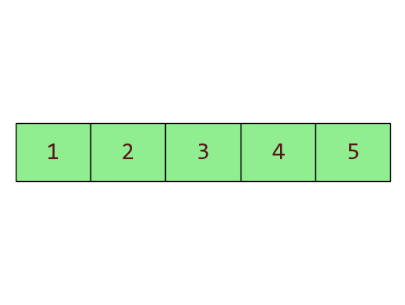

Списки можуть містити різні типи даних:

```py
my_list = [1, "Hello", 3.14]
```

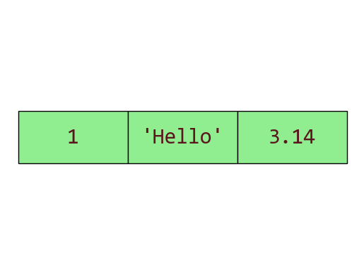

Якщо ви хочете додати щось до свого списку, використовуйте метод `append()`. Подумайте про це як про додавання нової коробки в кінець свого ряду коробок. Наприклад, `my_list.append(4)` додасть число 4 в кінець списку.

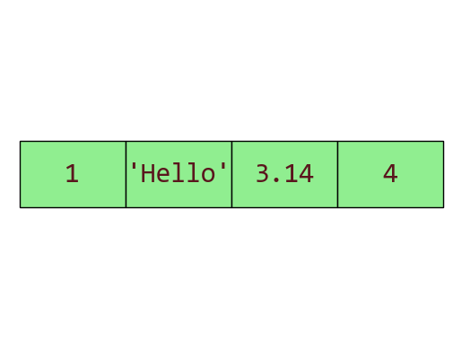

Для додавання нового елемента до списку ми використали **метод**.

Але що таке метод?

> 💡 Метод у Python — це функція, яка "прикріплена" до об'єкта і виконує дії, пов'язані з цим об'єктом. Кожен тип об'єкта має свій набір методів.

Наприклад, у списків є методи для додавання та видалення елементів, обчислення довжини списку тощо. Як ви зрозуміли, список і є об'єкт. Свої об'єкти ми навчимося створювати, коли будемо вивчати класи. А зараз, щоб використовувати метод, тобі потрібно вказати об'єкт `my_list`, а потім через крапку написати назву методу і в дужках додати необхідні аргументи `my_list.append(4)`, якщо вони, звісно, потрібні.

Щоб видалити елемент списку, використовуй метод `remove()`. Аргументом метод `remove` приймає елемент списку, який потрібно видалити. Наприклад, виклик методу `my_list.remove("Hello")` видалить рядок `"Hello"` зі списку.

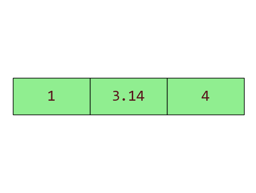

Під *впорядкованістю* варто розуміти властивість контейнера зберігати порядок елементів при роботі з ним. Видаляючи елемент, додаючи новий, роблячи вставку/видалення з кінця/початку/середини контейнера, ти гарантуєш, що всі елементи, окрім тих, яких безпосередньо стосувалася операція, зберігають порядок.

Найкориснішою властивістю впорядкованості є можливість доступу до елементів контейнера за індексом цього елемента в контейнері.

У Python синтаксис доступу за індексом виглядає так:

```py
some_iterable = ["a", "b", "c"]
first_letter = some_iterable[0]
middle_one = some_iterable[1]
last_letter = some_iterable[2]
```

У першому рядку ми створили список `some_iterable` із трьох перших літер англійського алфавіту.


Розглянемо докладно операції, які ми тут виконали. У другому рядку ми зберегли у змінну `first_letter` літеру `"a"`  — це перший елемент списку `some_iterable`. Індекс елементів у списків Python починається з `0`, як і в більшості мов програмування, тому індекс елемента `"a"` дорівнює `0`.

Третій рядок — це звернення до другого елемента списку `some_iterable`, його індекс дорівнює `1` — це літера `"b"` і ми зберігаємо її у змінній `middle_one`.

Четвертий рядок — це звернення до останнього елемента списку `some_iterable`, літери `"c"`, яку ми збережемо у змінній `last_letter`, а індекс елемента дорівнює `2`.

Python підтримує індексування елементів з кінця. Для цього потрібно додати `-` і вказати номер елемента з кінця. Оскільки у Python `-0 == 0`, то перший елемент з кінця — це `-1`, другий — `-2` і так далі. Наш приклад можна переписати, використовуючи індексування з кінця, ось так:

```py
some_iterable = ["a", "b", "c"]
first_letter = some_iterable[-3]
middle_one = some_iterable[-2]
last_letter = some_iterable[-1]
```

Найкориснішою властивістю *змінності* списків є можливість змінити значення будь-якого елемента списку:

```py
some_iterable = [1, 2, 3]
```

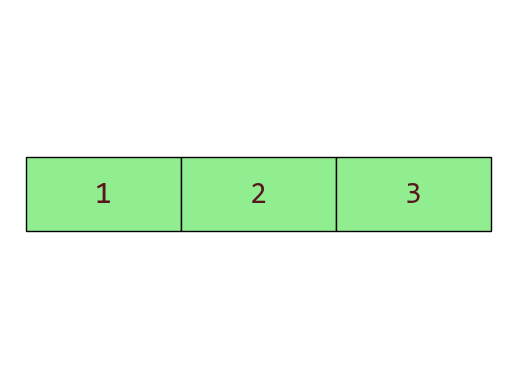

Змінимо другий елемент списку `some_iterable` на `-2`. Другий елемент списку має індекс `1`, а отже:

```py
some_iterable[1] = -2
```

І список тепер матиме наступний вигляд:

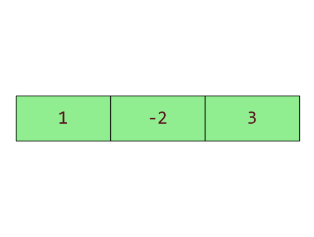

Розглянемо, які ще методи списків нам доступні.

Щоб повернути елемент за індексом `i` та видалити його зі списку, ми використовуємо метод `pop(i)`. За замовчуванням `i = -1`, і метод повертає останній елемент списку.

Нехай у нас є наступний список із букв:

```py
chars = ['a', 'b', 'c']
```

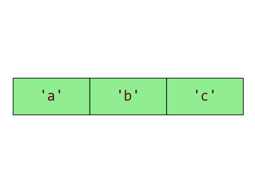

Якщо ми викличемо метод `pop` з індексом `1`, то змінна `last` буде зберігати значення `"b"`. Оскільки індекс елемента `"b"` саме дорівнює `1`.

```py
last = chars.pop(1)
```

Сам список набуде наступного вигляду, вже без елемента `"b"`.

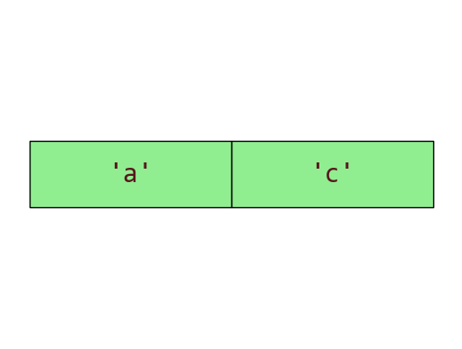

Якщо виникає потреба розширити один список іншим, то використовують метод `extend`. Наприклад, ми маємо два списки `chars` та `numbers` і хочемо, щоб у список `chars` додалися всі елементи списку `numbers`.

```py
chars = ['a', 'b', 'c']
numbers = [1, 2]
```

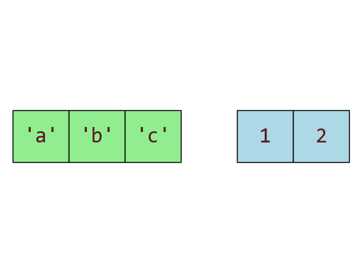

Використовуючи наступну операцію, ми розширимо список `chars` елементами списку `numbers`. Список `numbers` при цьому не зазнає змін.

```py
chars.extend(numbers)
```

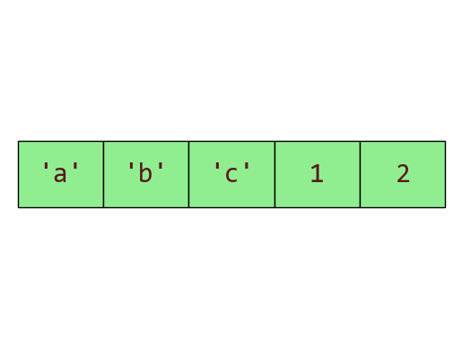

Для вставки елемента `x` на позицію з індексом `i` у список ми використовуємо метод `insert(i, x)`. Розглянемо приклад, сформуємо список `chars`

```py
chars = ["a", "c"]
```


Та за допомогою методу `insert` вставимо між символами `"a"` і `"c"` елемент із символом `"b"`. Це місце з індексом `1`, де зараз знаходиться символ `"c"`, отже, треба виконати наступний виклик методу `insert`.

```py
chars.insert(1, "b")
```


Для очищення списку від елементів треба використати метод `clear()`. Після цього список буде пустим, без жодного елемента.

```py
chars = ['a', 'b']
chars.clear() # []
```

Метод `index()` у списках Python використовується для знаходження індексу першого входження заданого елемента у списку. Якщо елемент не знаходиться у списку, Python викине помилку `ValueError`. Обробляти такі помилки ми навчимося далі по курсу.

```py
chars = ['a', 'b', 'c', 'd']
c_ind = chars.index('c')
```

У нашому випадку змінна `c_ind` зберігає значення `2` — це індекс елемента `'c'` у списку `chars`.

Метод `count()` у списках Python використовується для підрахунку кількості разів, скільки певний елемент зустрічається у списку. Цей метод корисний, коли вам потрібно дізнатися, чи часто і як часто певний елемент присутній у списку. У наступному прикладі ми підрахуємо, скільки чисел `2` зустрічається у списку `my_list`.

<small>✂️ Цей код можна запустити!</small>

```py
my_list = [1, 2, 3, 4, 2, 2, 5, 2]
count_2 = my_list.count(2)
print(count_2)  # Виведе 4, оскільки число 2 зустрічається 4 рази
```

Якщо елемент відсутній у списку, `count()` поверне `0`. Метод `count()` є простим і ефективним способом для визначення частоти елементів у списку, що може бути корисним у різних сценаріях аналізу даних та обробки інформації.

Будь-яка колекція дозволяє дізнатися кількість елементів у ній за допомогою вбудованої функції `len`.

<small>✂️ Цей код можна запустити!</small>

```py
my_list = [1, 2, 3, 4, 5]
print(len(my_list))
```

Тут функція `print` поверне `5` — кількість елементів у списку.

Метод `sort()` у списках Python використовується для сортування елементів списку в порядку зростання або спадання. Цей метод модифікує вихідний список, тобто сортування відбувається "на місці", і він не створює новий відсортований список.

За замовчуванням `sort()` впорядковує елементи списку за зростанням, від меншого до більшого.

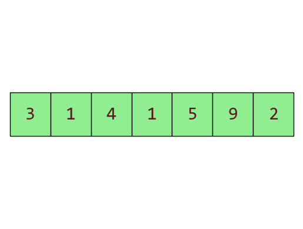

<small>✂️ Цей код можна запустити!</small>

```py
nums = [3, 1, 4, 1, 5, 9, 2]
nums.sort()
print(nums)  # Виведе [1, 1, 2, 3, 4, 5, 9]
```

Якщо потрібно відсортувати елементи в порядку спадання, використовуй аргумент `reverse=True`.

<small>✂️ Цей код можна запустити!</small>

```py
nums.sort(reverse=True)
print(nums)  # Виведе [9, 5, 4, 3, 2, 1, 1]
```

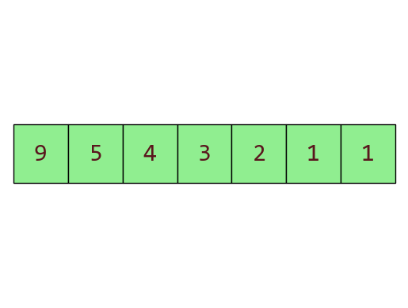

Метод `sort()` також дозволяє сортувати за ключем, який визначає, як порівнювати елементи. Це може бути корисним, наприклад, при сортуванні списків, які містять вкладені колекції, або коли елементами списку є об'єкти.

Наприклад, у наступному прикладі ми відсортуємо список за довжиною слова у списку.


<small>✂️ Цей код можна запустити!</small>

```py
words = ["banana", "apple", "cherry"]
words.sort(key=len)
print(words)  # Виведе ['apple', 'banana', 'cherry']
```

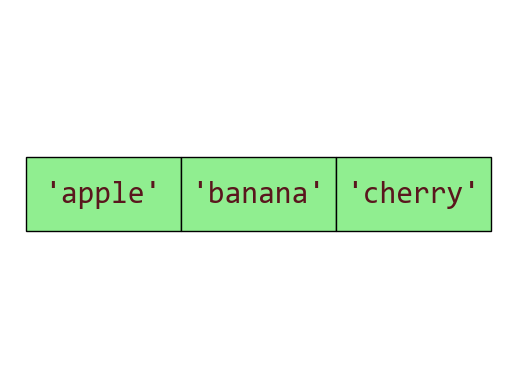

Пам'ятайте, що метод `sort()` змінює сам список, на якому він був викликаний. Якщо потрібно зберегти початковий порядок елементів, розгляньте можливість створення копії списку перед сортуванням або використай функцію `sorted()`, яка повертає новий відсортований список. Також `sort()` працює тільки зі списками, де всі елементи можуть бути порівняні між собою. Наприклад, спроба відсортувати список, який містить і цифри, і рядки, призведе до помилки.

Вбудований метод `sorted()` у Python використовується для сортування колекцій. Він відрізняється від методу `sort()`, який застосовується безпосередньо до списку, та змінює його: `sorted()` повертає новий відсортований об'єкт, залишаючи вихідний об'єкт без змін. Метод також використовує аргумент `reverse=True`, щоб відсортувати об'єкти у зворотному порядку, та за допомогою аргументу `key` можна вказати функцію, яка буде застосовуватися для визначення порядку сортування.

Сортування списку:

<small>✂️ Цей код можна запустити!</small>

```py
nums = [3, 1, 4, 1, 5, 9, 2]
sorted_nums = sorted(nums)
print(sorted_nums)  # Виведе [1, 1, 2, 3, 4, 5, 9]
```

Сортування у зворотному порядку:

<small>✂️ Цей код можна запустити!</small>

```py
sorted_nums_desc = sorted(nums, reverse=True)
print(sorted_nums_desc)  # Виведе [9, 5, 4, 3, 2, 1, 1]
```

Сортування за довжиною:

<small>✂️ Цей код можна запустити!</small>

```py
words = ["banana", "apple", "cherry"]
sorted_words = sorted(words, key=len)
print(sorted_words)  # Виведе ['apple', 'banana', 'cherry']
```

Оскільки `sorted()` повертає новий список, його можна використовувати з будь-якою колекцією, не тільки зі списками. Це робить `sorted()` дуже універсальним інструментом для сортування даних, незалежно від того, чи є вихідний об'єкт змінним.

Щоб повернути копію списку, ми використовуємо метод `copy()`.

```py
chars =  ['a', 'b']
chars_copy = chars.copy()
```

У цьому прикладі ми створили змінну `chars_copy`, де зберегли копію списку `chars`, і тепер можемо виконувати будь-які дії над списком, бо в нас є збережена копія, до якої ми можемо завжди повернутися.

І останній метод списків, який ми розглянемо — це метод `reverse()`. Він використовується, щоб змінити порядок елементів у списку на зворотний.

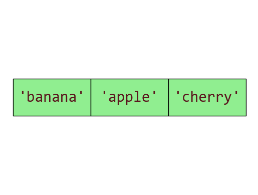

```py
chars = ["banana", "apple", "cherry"]
chars.reverse()
```

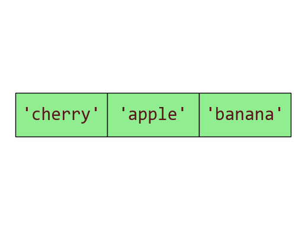

#### Словники

Словник — це контейнер, який зберігає пари ключ-значення. Ключем може бути будь-який незмінний тип даних Python (число, рядок, кортеж тощо).

Неможливо використовувати в якості ключа списки, словники, множини або будь-які інші змінювані типи даних. Значенням словника може бути будь-який тип даних Python, включаючи призначені для користувача типи.

Словники використовуються для зберігання даних, які можна легко визначити та змінити за допомогою унікального ключа.

Створення пустого словника:

```py
my_dict = {}
```

Для створення заповненого деякими значеннями словника достатньо перелічити пари ключ-значення через кому всередині фігурних дужок — ключ іде першим, потім двокрапка та значення.

```py
my_dict = {"name": "Alice", "age": 25, "city": "New York"}
```

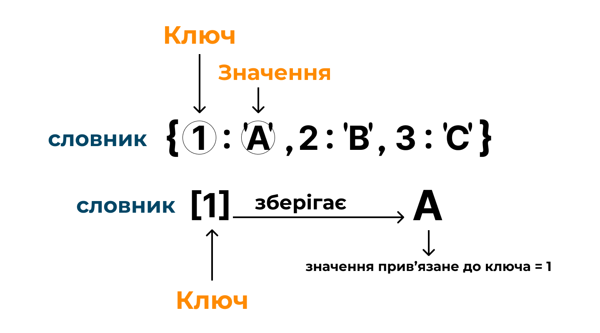

Раніше словники не зберігали порядок елементів, хоча, починаючи з версії Python 3.7, порядок вставлення зазвичай зберігається. Словники в першу чергу оптимізовані для швидкого доступу до значень за ключами, що робить їх ідеальними для використання у випадках, коли потрібен швидкий пошук даних.

Можна виконувати різні операції зі словниками, такі як доступ до елементів, їх зміна, додавання, видалення, а також перевірка наявності ключів.

Для доступу до значення у словнику за ключем використовуйте квадратні дужки із ключем. Наприклад, у нас є словник `my_dict` із ключем `"name"`, і ми можемо отримати відповідне значення так:

```py
my_dict = {"name": "Alice", "age": 25, "city": "New York"}
print(my_dict["name"])  # Виведе 'Alice'
```

Щоб змінити значення або додати нову пару ключ-значення, просто використовуйте ключ для присвоєння нового значення:

<small>✂️ Цей код можна запустити!</small>

```py
my_dict["age"] = 26  # Змінює вік на 26
my_dict["email"] = "alice@example.com"  # Додає нову пару ключ-значення
print(my_dict)
```

Виведе:

```py
{'name': 'Alice', 'age': 26, 'city': 'New York', 'email': 'alice@example.com'}
```

Ми змінили значення ключа `"age"` з `25` на `26` та додали нову пару ключ-значення `'email': 'alice@example.com'` у словник. Видалити елемент за ключем можна за допомогою оператора `del`:

<small>✂️ Цей код можна запустити!</small>

```py
del my_dict["age"]
print(my_dict)
```

Виведе:

```py
{'name': 'Alice', 'city': 'New York', 'email': 'alice@example.com'}
```

Для перевірки, чи є ключ у словнику, використовуй оператор `in`:

<small>✂️ Цей код можна запустити!</small>

```py
print("name" in my_dict)
print("age" in my_dict)
```

Виведе:

```bash
True
False
```

Бо ключ `"name"` залишився у словнику `my_dict`, а ключ `"age"` ми видалили.

Ці операції дозволяють ефективно керувати даними всередині словника, роблячи словники однією з найбільш універсальних і потужних структур даних у Python.

##### Методи словників

Розглянемо методи словників, які найчастіше ми будемо використовувати надалі в курсі.

###### Метод `pop()`

Почнемо з методу `pop()`, який у словниках дозволяє видалити елемент за вказаним ключем і повернути його значення. Наприклад, якщо ми маємо словник `my_dict = {"name": "Alice", "age": 25}` і виконуємо `age = my_dict.pop("age")`, то змінна `age` отримає значення `25`, а пара ключ-значення `"age": 25` буде видалена зі словника. Якщо ключ не знайдено, метод викидає помилку, але можна встановити значення за замовчуванням другим аргументом, яке повертатиметься в такому випадку.

###### Метод `update()`

Метод `update()` використовується для оновлення словника іншим словником або парами ключ-значення. Якщо в вас є словник `my_dict = {"name": "Alice", "age": 25}` і ви виконаєте `my_dict.update({"email": "alice@example.com", "age": 26})`, то словник `my_dict` буде оновлено новими парами ключ-значення, де ключ `"email"` буде додано в словник, а значення ключа `"age"` буде оновлено.

```py
{'name': 'Alice', 'email': 'alice@example.com', 'age': 26}
```

###### Метод `clear()`

Метод `clear()` очищує словник, видаляючи всі його елементи. Після виклику `my_dict.clear()`, `my_dict` стане порожнім словником `{}`.

###### Метод `copy()`

Метод `copy()` створює поверхневу копію словника. Якщо використати `new_dict = my_dict.copy()`, то `new_dict` буде новим словником з тими самими парами ключ-значення, що і `my_dict`, але як окремий об'єкт.

###### Метод `get()`

Метод `get()` використовується для безпечного отримання значення за ключем зі словника. Основна перевага цього методу полягає в тому, що він не викликає помилку, якщо ключ не знайдено. Натомість, якщо ключ відсутній, `get()` повертає `None` або інше значення, яке ви можете визначити як значення за замовчуванням.

```py
my_dict = {"name": "Alice", "age": 25}
age = my_dict.get("age")  # Поверне 25
gender = my_dict.get("gender")  # Поверне None, оскільки "gender" немає в словнику
```

Коли ви використовуєте квадратні дужки `[]` для доступу до значення за ключем, отримаєте значення, якщо ключ існує. Проте, якщо ключ відсутній, Python викине помилку `KeyError`.

```py
pythonCopy code
name = my_dict["name"]  # Поверне 'Alice'
gender = my_dict["gender"]  # Викличе KeyError, оскільки "gender" немає в словнику
```

Головна різниця між використанням `get()` та прямим доступом до значення за ключем полягає в тому, як обробляється відсутність ключа. Метод `get()` є більш безпечним, оскільки він запобігає виникненню помилки `KeyError` та дозволяє тобі встановити значення за замовчуванням для випадків, коли ключ не знайдено. Отже, в майбутньому краще використовуй метод `get()` для отримання значення за ключем зі словника.

#### Множини

Множини — це неврегульований контейнер, який містить тільки унікальні елементи. У множину можна додавати тільки незмінні типи даних.

Щоб створити порожню множину, потрібно викликати функцію `set()`

```py
empty_set = set()
```

Множини не мають визначеного порядку елементів. Це означає, що ви не можете звернутися до елементів множини через індекс або отримати їх у певному порядку.

Для створення заповненої множини достатньо передати будь-який об'єкт, що ітерується, у функцію `set`:

```py
a = set('hello')
```

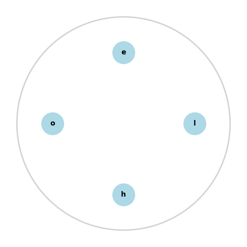

Або ж скористатися синтаксисом з фігурними дужками (як у словниках), але елементи у фігурних дужках просто перелічити через кому без двокрапок:

```py
b = {1, 2, 3, 4, 5}
```

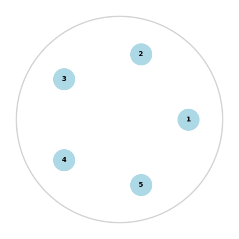

Унікальність множини передбачає, що якщо множина вже містить такий елемент, то спроба додати ще один такий самий нічого не змінить.

```py
numbers = {1, 2, 3, 1, 2, 3}
```

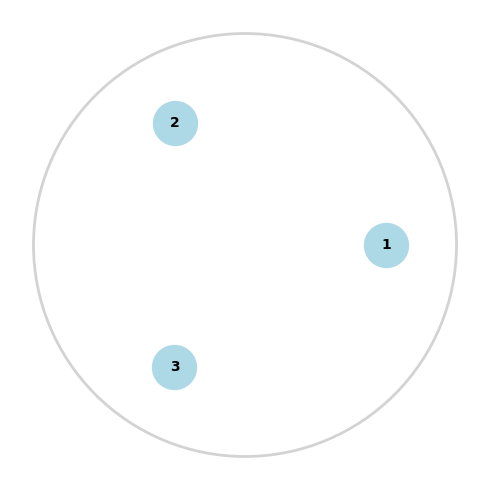

Тому множини часто використовуються, коли потрібно забезпечити унікальність елементів, наприклад, для видалення дублікатів зі списку. Вони також корисні в ситуаціях, де потрібно виконати швидкі перевірки на наявність елемента.

**Приклад.** Нехай у нас є список, з якого треба видалити дублікати

```py
lst = [1, 2, 3, 1, 2, 2, 3, 4, 1].
```

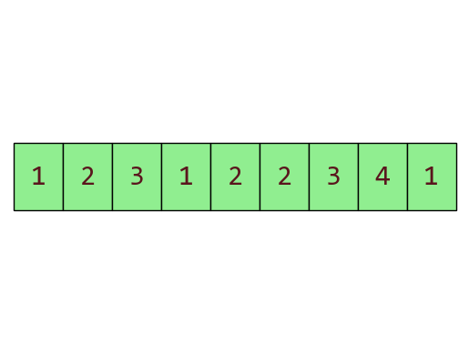

Це можна зробити, перетворивши список у множину `d_lst = set(lst)`.

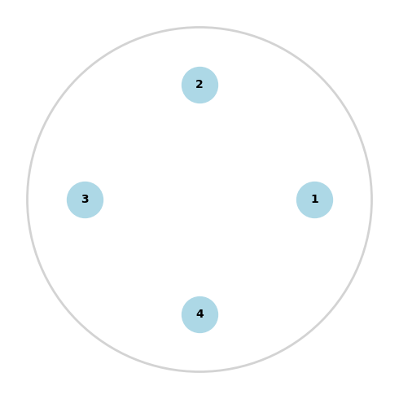

А далі множину перетворити знову у список `lst=list(d_lst)`.

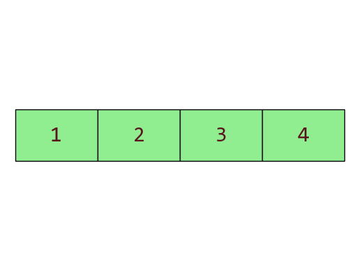

Усе, так легко ми прибрали дублікати зі списку.

Множини підтримують наступні методи:

- `add(elem)` — додає елемент у множину

<small>✂️ Цей код можна запустити!</small>

```py
numbers = {1, 2, 3}
numbers.add(4)
print(numbers)  # {1, 2, 3, 4}
```

- `remove(elem)` — видаляє елемент із множини, викликає виняток, якщо такого елемента немає

<small>✂️ Цей код можна запустити!</small>

```py
numbers = {1, 2, 3}
numbers.remove(3)
print(numbers)  # {1, 2}
```

- `discard(elem)` — видаляє елемент із множини і не викликає виняток, якщо його немає

<small>✂️ Цей код можна запустити!</small>

```py
numbers = {1, 2, 3}
numbers.discard(2)
print(numbers)  # {1, 3}
```

##### Математичні операції над множинами

Розглянемо детальніше, які корисні математичні операції можна робити над множинами. Спершу створимо дві множини `a` і `b`:

```py
a = {1, 2, 3}

b = {3, 4, 5}
```

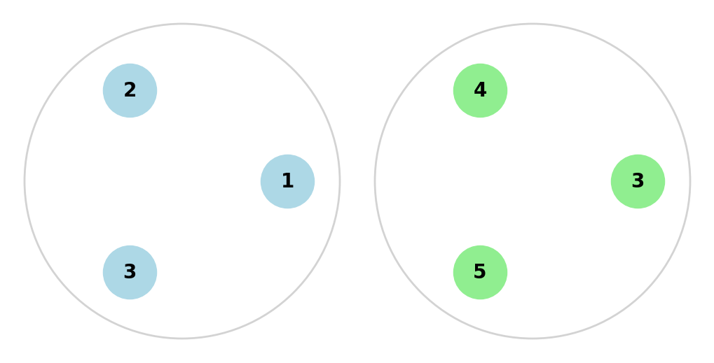

Перетин двох множин включає лише ті елементи, які є в обох множинах. Щоб знайти загальні елементи для двох множин, над ними треба виконати операцію `&` або використати метод `intersection`:

<small>✂️ Цей код можна запустити!</small>

```py
a = {1, 2, 3}
b = {3, 4, 5}
print(a.intersection(b))  # {3}
print(a & b)  # {3}
```

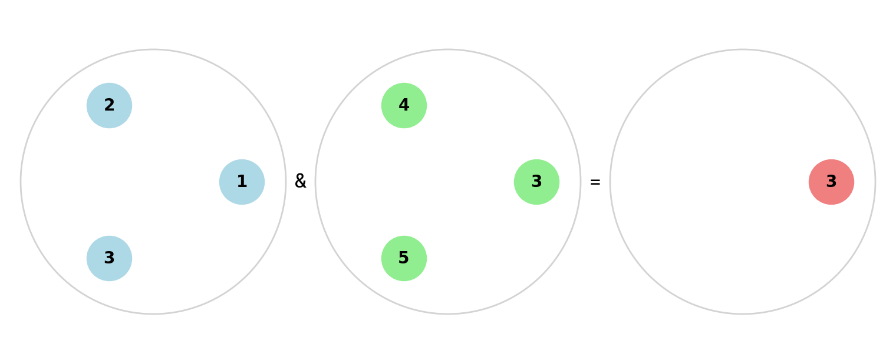

Різниця між двома множинами включає елементи, які містяться в першій множині, але не містяться в другій. Можна також використовувати оператор `-` або метод `difference`:

<small>✂️ Цей код можна запустити!</small>

```py
a = {1, 2, 3}
b = {3, 4, 5}
print(a.difference(b))  # {1, 2}
print(a - b)  # {1, 2}
```

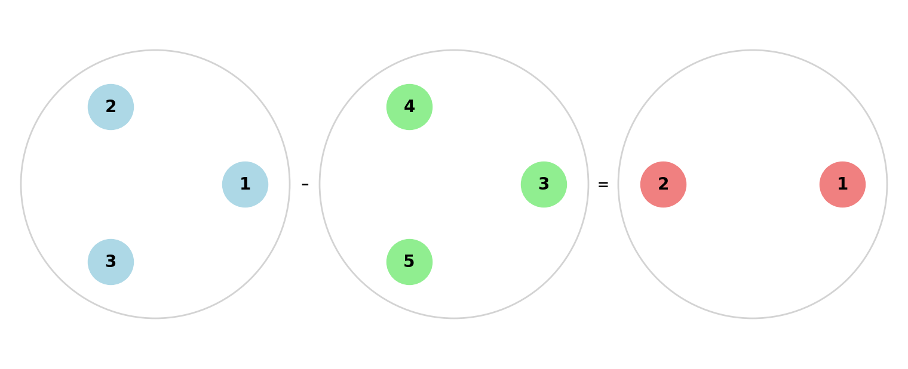

Симетрична різниця між двома множинами включає всі елементи, які містяться в одній множині, але не містяться в іншій, і навпаки. Щоб знайти всі елементи з двох множин, окрім загальних, нам необхідно використати оператор `^`.

Альтернативно, можна використовувати метод `symmetric_difference`:

<small>✂️ Цей код можна запустити!</small>

```py
a = {1, 2, 3}
b = {3, 4, 5}
print(a.symmetric_difference(b))  # {1, 2, 4, 5}
print(a ^ b)  # {1, 2, 4, 5}
```

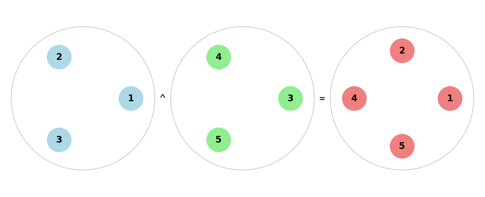

Об'єднання двох множин включає всі елементи з обох множин, але без дублікатів. Це знаходиться за допомогою оператора `|` або методу `union`:

<small>✂️ Цей код можна запустити!</small>

```py
a = {1, 2, 3}
b = {3, 4, 5}
print(a.union(b))  # {1, 2, 3, 4, 5}
print(a | b)  # {1, 2, 3, 4, 5}
```

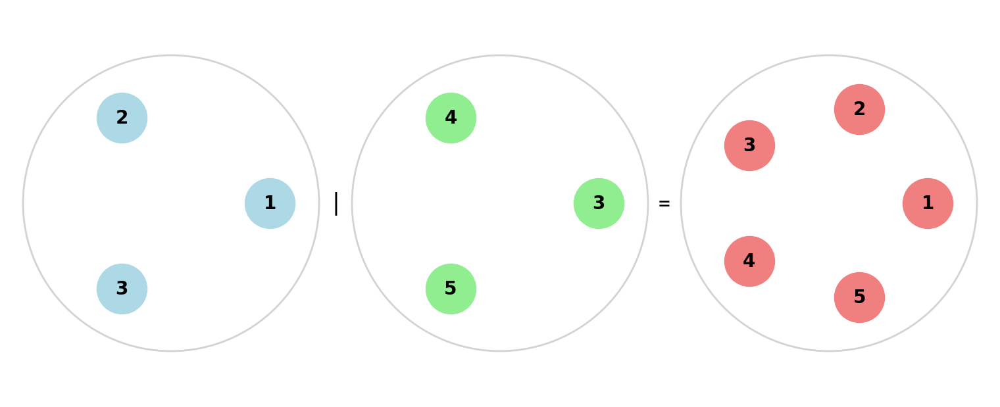

Множини — це дуже потужний інструмент, коли необхідно знайти унікальні елементи в якомусь наборі і прибрати дублікати, а також найшвидший спосіб знайти загальні або відмінні елементи з декількох наборів.

Заморожені множини в Python, відомі як `frozenset`, є подібними до звичайних множин `set`, але з ключовою відмінністю: вони є незмінними. Це означає, що після створення замороженої множини ви не можете додати або видалити елементи з неї.

Заморожену множину можна створити за допомогою функції `frozenset()`:

<small>✂️ Цей код можна запустити!</small>

```py
my_frozenset = frozenset([1, 2, 3, 4, 5])
```

У цьому прикладі ми створили заморожену множину з п'яти чисел.

Неможливо змінити елементи замороженої множини після її створення. Ви не зможете використовувати методи `add()` або `remove()`, як у випадку зі звичайними множинами. Заморожені множини можуть використовуватися в якості ключів у словниках або як елементи інших множин, тому що вони є хешованими (і, отже, незмінними).

Хоча ви не можете змінювати заморожені множини, над ними все ще можна виконувати різні операції, які не змінюють саму множину, такі як об'єднання, перетин і різниця:

<small>✂️ Цей код можна запустити!</small>

```py
a = frozenset([1, 2, 3])
b = frozenset([3, 4, 5])

union = a | b  # Об'єднання множин
intersection = a & b  # Перетин множин
difference = a - b  # Різниця множин
symmetric_difference = a ^ b  # Симетрична різниця

print(union)  # frozenset({1, 2, 3, 4, 5})
print(intersection)  # frozenset({3})
print(difference)  # frozenset({1, 2})
print(symmetric_difference)  # frozenset({1, 2, 4, 5})
```

У цих прикладах результатом кожної операції буде нова заморожена множина.

Заморожені множини корисні у випадках, коли тобі потрібно мати набір унікальних елементів, який не змінюватиметься, та коли потрібна можливість використовувати множини як ключі у словниках або як елементи інших множин.

#### Кортежі

Кортежі в Python — це важлива структура даних, подібна до списків, але з ключовою відмінністю: **вони незмінні**. Це означає, що після створення кортежу, не можна змінити його елементи, не можна додавати/видаляти/переставляти елементи. При спробі змінити кортеж, ви отримаєте повідомлення про помилку.

Розглянемо основні аспекти кортежів. Щоб створити порожній кортеж, існують два способи, хоча й не зовсім зрозуміло, навіщо потрібний порожній кортеж 😄:

```py
my_tuple = tuple() # або
my_tuple = ()
```

Створення ж непорожніх кортежів відбувається наступним чином:

```py
my_tuple = (1, 2, 3)
```

Якщо ви хочете створити кортеж з одним елементом, не забудьте поставити кому. Це важливо, запам'ятай це! Інакше ви отримаєте змінну, яка просто зберігає елемент кортежу.

```py
my_tuple = (1,)
```

Річ у тому, що Python використовує круглі дужки як математичні символи. Якщо написати вираз на кшталт `my_tuple = (1)`, виникає невизначеність.

Інтерпретатор розуміє такий вираз як суто математичний і просто прибирає зайві дужки, присвоюючи `my_tuple` значення `1`. Щоб вказати, що це не математична операція, а саме кортеж, потрібно додати кому після значення.

Тоді інтерпретатор однозначно зрозуміє, що ви хочете створити кортеж з одним елементом:

Кортеж, як і список, може містити різні типи даних:

```py
my_tuple = (1, "Hello", 3.14)
```

Кортеж можна створити без дужок, ця операція називається упакування кортежу:

```py
my_tuple = 1, "Hello", 3.14
```

Із операції з кортежами ми маємо фактично тільки доступ до елементів. Ми можемо отримати доступ до елементів кортежу за допомогою індексації.

```py
first_item = my_tuple[0]  # Отримати перший елемент
```

Оскільки кортежі є незмінними, неможна додавати, видаляти або змінювати їх елементи після створення. Це робить їх ідеальними для використання в ситуаціях, де потрібно гарантувати, що дані залишаться без змін.

Кортежі використовуються в багатьох сценаріях, наприклад, для зберігання набору констант або коли функція повертає кілька значень. Також вони корисні в якості ключів словників, оскільки ключі повинні бути незмінними.

Незмінність кортежів обмежує їх застосування, в порівнянні зі списками, але дає можливість використати кортежі як ключі для словника або елементи множини.

Наприклад, розглянемо набір точок на площині (кортежі). Їх можна використовувати як ключі у словнику:

```py
points = {
    (0, 0): "O",
    (1, 1): "A",
    (2, 2): "B"
}
```

У словнику `points` використовуються кортежі з координатами точок як ключі, а значення — це імена (назва) точок.

> **!** 💡 Головна різниця між кортежами та списками полягає в їхній незмінності. Кортежі — це чудовий вибір, коли тобі потрібна впорядкована колекція, яка не повинна змінюватися. Списки ж ідеально підходять для випадків, коли тобі потрібна подібна до кортежу структура, але з можливістю модифікації.

#### Методи рядків

**Рядок** — це незмінна впорядкована послідовність символів у деякому кодуванні. За замовчуванням використовується кодування [UTF-8](https://uk.wikipedia.org/wiki/UTF-8), але можна працювати майже з усіма відомими таблицями кодування символів.

У Python рядок теж можна розглядати як колекцію символів. Це означає, що рядки підтримують багато операцій, які зазвичай застосовуються до колекцій, таких як списки.

Важливо тільки пам'ятати, що рядки в Python є незмінними (immutable), це значить, що ви не можете змінити окремі символи в рядку без створення нового рядка.

Ми вже знаємо: щоб створити змінну типу "рядок", необхідно певний набір символів взяти в лапки. Ми будемо в основному використовувати два варіанти:

- Варіант перший — рядок береться в одинарні лапки (апостроф) `'some text'`
- Варіант другий — рядок береться в подвійні лапки `"some text"`

Різні варіанти використання лапок обумовлені тим, що при використанні одинарних лапок можна в рядку вказати подвійні та навпаки.

```py
game_string = 'My favorite "Game"'
```

Бо інколи в тексті нам треба показати, що ми працюємо саме з рядком.

**Впорядкована послідовність** означає, що до елементів рядка можна звертатися за індексом:

<small>✂️ Цей код можна запустити!</small>

```py
s = "Hello world!"
print(s[0])# H
print(s[-1])# !
```

**Незмінна послідовність** означає, що якщо рядок уже створений, то змінити його не можна, можна тільки створити новий.

```py
s = "Hello world!"
s[0] = "Q"# Тут буде викликано виняток (помилка) TypeError
```

У Python рядки мають багато корисних "малих" методів, які дозволяють виконувати різноманітні операції обробки тексту. Ці методи дуже корисні для обробки та перетворення текстових даних у Python. Вони дозволяють виконувати найрізноманітніші задачі, пов'язані з рядками, від простого форматування до більш складної обробки тексту.

Для того, щоб усі літери рядка перевести у верхній регістр, використовується метод `upper`:

<small>✂️ Цей код можна запустити!</small>

```py
s = "Hello" 
print(s.upper()) # Виведе 'HELLO'
```

Для переведення в нижній регістр використовується метод `lower()`:

<small>✂️ Цей код можна запустити!</small>

```py
s = "Some Text"
print(s.lower())  # Виведе 'some text'
```

Щоб перевірити, що рядок починається з підрядка, є метод `startswith`:

<small>✂️ Цей код можна запустити!</small>

```py
s = "Bill Jons"
print(s.startswith("Bi"))  # Виведе True
```

Щоб перевірити, що рядок закінчується підрядком, використовується метод `endswith`:

<small>✂️ Цей код можна запустити!</small>

```py
s = "hello.jpg"
print(s.endswith("jpg"))  # Виведе True
```

Цей метод зручно використовувати для перевірки розширення файлів.

Метод `capitalize` робить перший символ рядка великою літерою, а інші — малими:

```py
s = "hello world".capitalize()  # Результат: "Hello world"
```

Метод `title` перетворює перші літери кожного слова в рядку на великі:

```py
s = "hello world".title()  # Результат: "Hello World"
```

Ще можуть стати в пригоді методи `isdigit`, `isalpha`, `isspace`, які перевіряють, чи складається рядок тільки з цифр, літер, пробілів тощо відповідно:

```py
"123".isdigit()  # True
"hello".isalpha()  # True
" ".isspace()  # True
```

Звісно, ми розглянули не всі методи, але ми ще повернемося в навчанні до роботи з методами рядків.

#### Форматування рядків

До появи `f`-рядків у Python активно використовували метод `format`.

Метод `format` у Python використовується для форматування рядків. Він замінює `{}` в рядку на аргументи, які передаються методу `format`. Це надзвичайно корисно для створення динамічних рядків.

Розглянемо декілька прикладів використання методу `format`:

<small>✂️ Цей код можна запустити!</small>

```py
# Просте форматування рядка
name = 'John'
print('Hello, {}!'.format(name))

# Форматування з декількома аргументами
age = 25
print('Hello, {}. You are {} years old.'.format(name, age))

# Використання іменованих аргументів
print('Hello, {name}. You are {age} years old.'.format(name='Jane', age=30))

# Використання індексів для вказівки порядку аргументів
print('Hello, {1}. You are {0} years old.'.format(age, name))
```

Виведення:

```py
Hello, John!
Hello, John. You are 25 years old.
Hello, Jane. You are 30 years old.
Hello, John. You are 25 years old.
```

## Зрізи у Python (Slice)

Для впорядкованих контейнерів є спеціальний синтаксис, коли нам необхідно отримати деяку послідовність елементів з контейнера.

Зрізи (slices) у Python — це потужний механізм для доступу до частин послідовностей, таких як рядки, списки та кортежі.

Зрізи визначаються за допомогою квадратних дужок `[]` із вказівкою індексів початку, кінця та (необов'язково) кроку. Ось основний синтаксис:

```py
послідовність[початок:кінець:крок]
```

- **початок** — індекс елемента, з якого починається зріз. Якщо він не вказаний, зріз починається з початку послідовності, з `0`.
- **кінець** — індекс елемента, до якого йде зріз, **але увага!**, не включаючи його. Якщо він не вказаний, зріз іде до кінця послідовності.
- **крок** — визначає крок, з яким вибираються елементи. Якщо не вказаний, використовується крок `1`.

Наприклад, якщо ми хочемо отримати перші 5 літер рядка:

<small>✂️ Цей код можна запустити!</small>

```py
s = "Hello, World!"
first_five = s[:5]
print(first_five)  # Виведе 'Hello'
```

Змінна `first_five` у цьому прикладі буде містити рядок `'Hello'`.

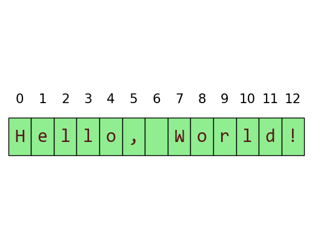

Зверніть увагу на малюнок: з індексом `5` у нас кома `,` і вона не була включена у зріз.

Візьмемо список чисел від 1 до 10 і збережемо окремо парні, непарні та кратні 3 числа.

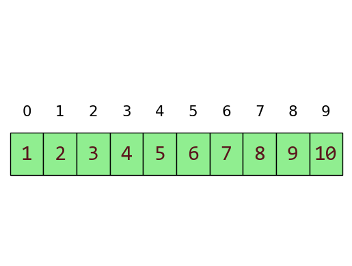

Спочатку отримаємо непарні числа списку.

```py
numbers = [1, 2, 3, 4, 5, 6, 7, 8, 9, 10]
odd_numbers = numbers[0:10:2]
```

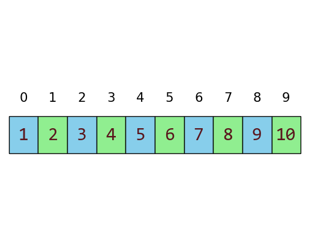

У списку `odd_numbers` ми беремо числа (на малюнку синього кольору), починаючи з індексу `0` до `10` з кроком `2`, отримаємо новий список `[1, 3, 5, 7, 9]`. Оскільки ми хочемо включити в перебори списку і десяте число (яке має індекс `9`), нам слід використати саме запис `numbers[0:10:2]`.

За замовчуванням Python розпочне зріз із початку і до кінця списку, тому ми могли б скоротити запис зрізу до виразу:

```py
odd_numbers = numbers[::2]  # Виведе [1, 3, 5, 7, 9]
```

Це те ж саме, що і запис `numbers[0:10:2]`.

Тепер отримаємо парні числа зі списку за допомогою зрізів.

```py
numbers = [1, 2, 3, 4, 5, 6, 7, 8, 9, 10]
even_numbers = numbers[1:10:2]
```

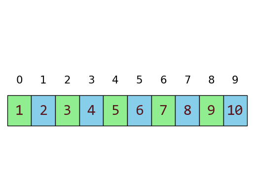

У `even_numbers` ми беремо числа, починаючи з індексу `1` до `10` з кроком `2`, та отримаємо список `[2, 4, 6, 8, 10]`. Тут теж можна скоротити запис зрізу та записати.

```py
even_numbers = numbers[1::2] # Виведе [2, 4, 6, 8, 10]
```

І нарешті отримаємо числа списку, кратні трьом.

```py
numbers = [1, 2, 3, 4, 5, 6, 7, 8, 9, 10]
three_numbers = numbers[2:10:3]
```

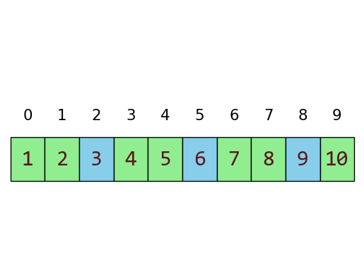

У `three_numbers` ми беремо числа, починаючи з індексу `2` до `10` з кроком `3`, та отримуємо список `[3, 6, 9]`. Скорочений запис — `three_numbers = numbers[2::3]`.

Ми можемо використовувати від'ємні індекси у зрізах. Із корисного, використання від'ємного кроку дозволяє "проходити" послідовність у зворотному порядку і фактично заміняє метод `reverse` для списків.

<small>✂️ Цей код можна запустити!</small>

```py
numbers = [1, 2, 3, 4, 5, 6, 7, 8, 9, 10]
reverse_numbers = numbers[::-1]
print(reverse_numbers)
```

Змінна `reverse_numbers` буде зберігати зворотний список `[10, 9, 8, 7, 6, 5, 4, 3, 2, 1]`

Щоб зробити копію списку в Python, можна замість методу `copy` використати зріз з усіма елементами оригінального списку. Зробити це дуже просто — треба створити зріз, який починається з першого елемента і йде до кінця списку. Ось як це виглядає на практиці:

<small>✂️ Цей код можна запустити!</small>

```py
numbers = [1, 2, 3, 4, 5, 6, 7, 8, 9, 10]
copy_numbers = numbers[:]
print(copy_numbers)
```

У цьому випадку `copy_numbers` є повною копією `numbers`. Зріз `[:]` вказує на вибір усіх елементів зі списку, починаючи з першого і закінчуючи останнім. Це створює новий список, який містить усі елементи оригінального списку, але є незалежним об'єктом. Якщо ти зміниш `copy_numbers`, це не вплине на `numbers`, і навпаки.

Зрізи — це надзвичайно корисний інструмент для роботи з послідовностями в Python, вони дозволяють легко й інтуїтивно отримувати підпослідовності або змінювати порядок елементів.