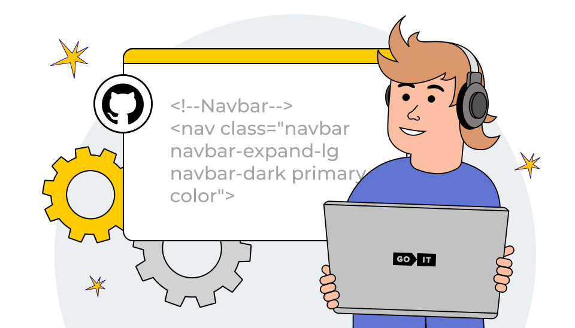
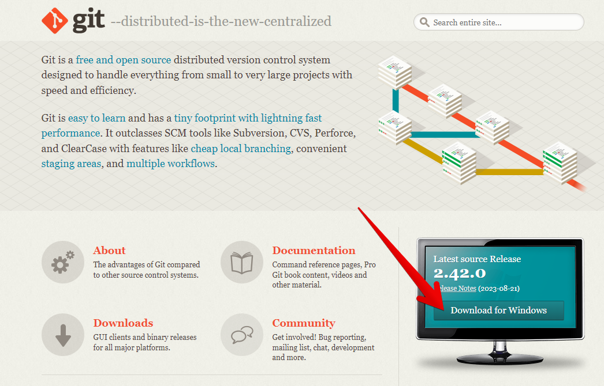
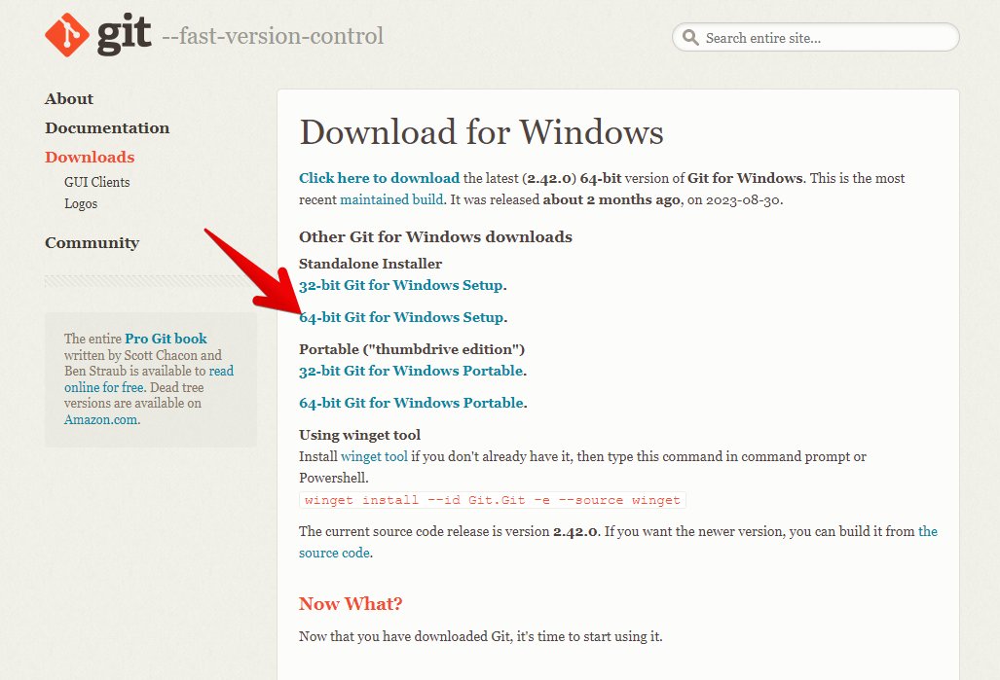
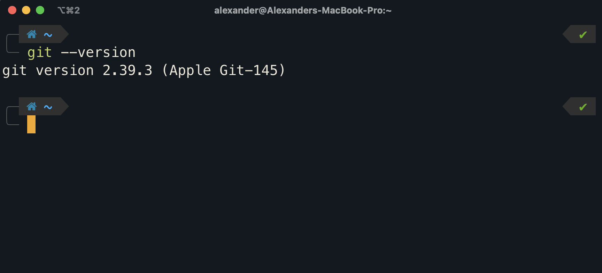
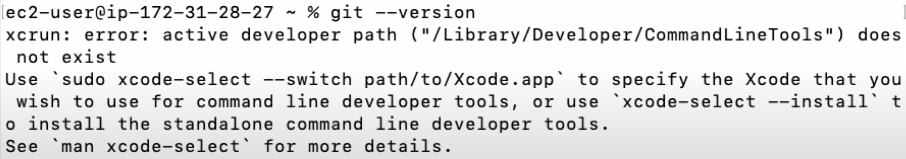
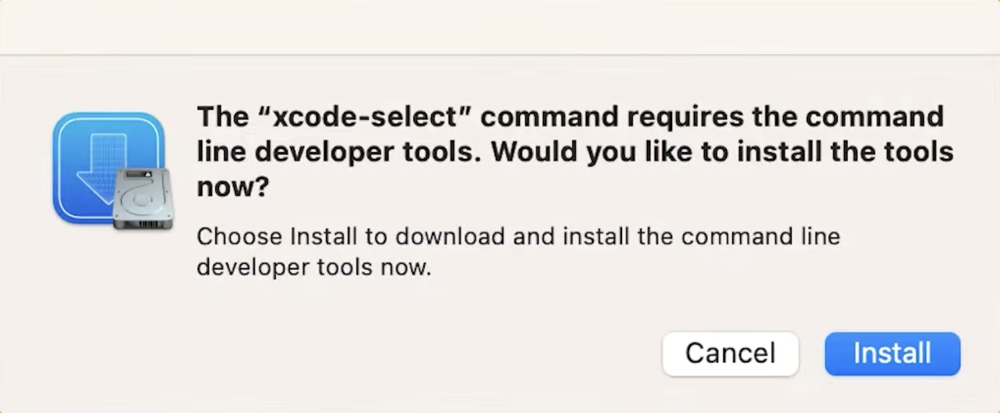
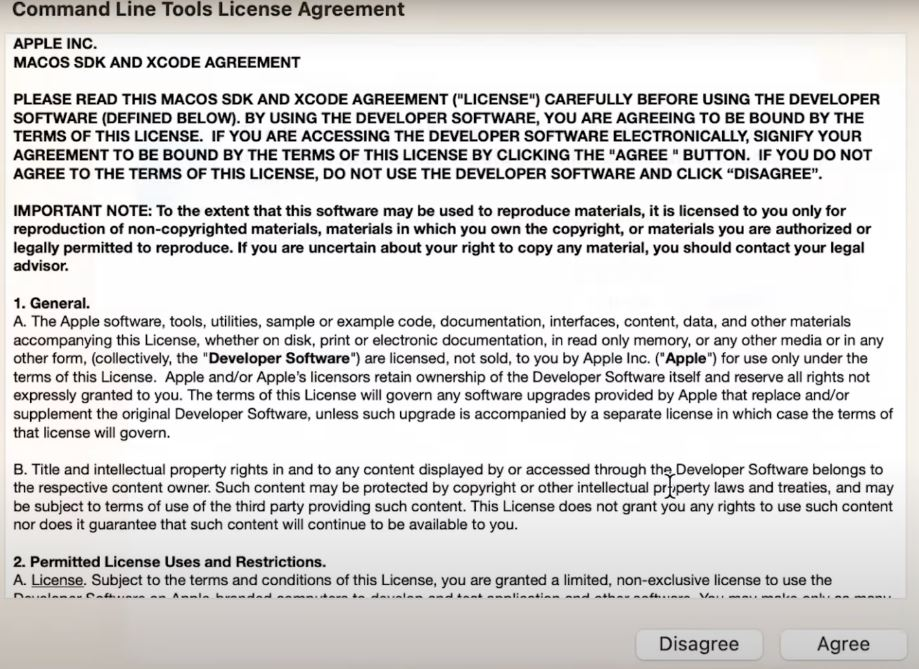
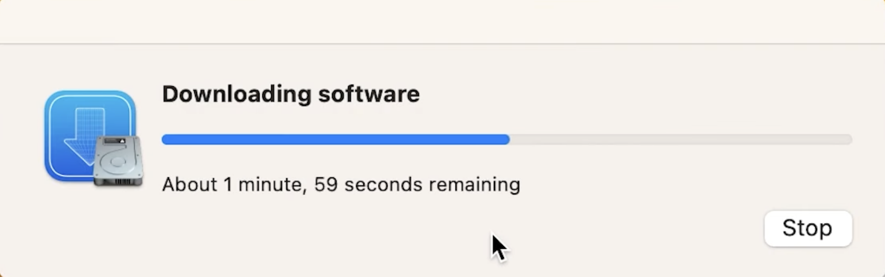
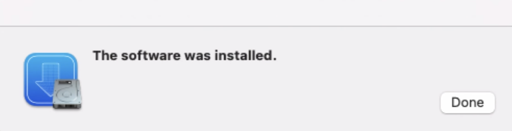
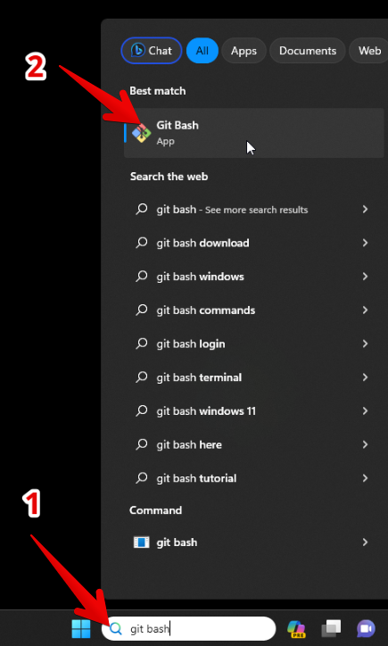

[Головна](../../README.md) / [Системи контролю версій Git і GitHub](../MAIN.md) / [GitHub. Робота з репозиторіями](./MAIN.md)

# GitHub. Робота з репозиторіями

## Система контролю версій
У сучасній програмній розробці кожен проєкт схожий на лабіринт.

Розробники постійно прокладають нові шляхи в коді, змінюють старі та інтегрують їх у більші системи. Однак, кожен новий маршрут є потенційно небезпечним: один неправильний крок може зробити код нестабільним або навіть непрацездатним.



У розв’язанні цієї проблеми на допомогу приходять системи контролю версій. Основне їх призначення полягає в управлінні версіями коду, але вони дозволяють робити набагато більше.

Однією з найбільш популярних і широко використовуваних систем контролю версій на сьогоднішній день є Git, який дозволяє:

- Зберігати **зміни**. Кожна версія твого коду зберігається, тому ти завжди можеш відновити попередній стан проєкту;
- **Координувати роботу в команді.** Ти можеш відслідковувати, хто, що і коли змінив, забезпечуючи прозорість і ефективність;
- **Створювати гілки для експериментів.** Можна безболісно експериментувати з новими функціями без ризику для основного проєкту.

Подумай про Git як про систему збереження у твоїх улюблених відеоіграх. Ти знаєш, що завжди можна зберегти свій прогрес перед важливим боєм або складним завданням. Якщо щось піде не так, ти просто повертаєшся до останнього збереженого стану і пробуєш знову. Гілки у Git працюють подібним чином: вони дозволяють тобі зберігати "чекпоінти" (англ. сheckpoint) для різних напрямків твого проєкту, що дає змогу експериментувати без ризику.

Git — це не просто інструмент для управління версіями, це комплексний інструмент для керування твоїм проєктом, що допомагає тобі не тільки зберігати твої кодові "скарби", але й керувати їх розвитком у команді або над індивідуальними проєктами. Це твій незамінний партнер у сучасному світі програмування.

## Git: система контролю версій

Git — це розподілена система контролю версій, створена Лінусом Торвальдсом, відомим розробником ядра Linux. Вона незамінна в сучасному програмуванні завдяки ряду функцій, які вона пропонує.


### Контроль версій

На відміну від простого зберігання файлів у папці, Git зберігає "знімки" всього проєкту на кожному етапі його життя. Це означає, що ти завжди можеш переглянути історію змін і, за потреби, відновити попередній стан коду.

### Гілкування та злиття

Git дозволяє створювати так звані "гілки" для розробки нових функцій або експериментів. Гілки дозволяють ізолювати роботу від основної кодової бази, що забезпечує безпеку і стабільність. Після завершення роботи гілку можна "злити" назад в основний код.

### Локальна та віддалена робота

Git є розподіленою системою. Отже, кожен розробник має повну копію всіх даних на своєму комп'ютері. Це дозволяє працювати локально і без постійного підключення до інтернету. Віддалені репозиторії (наприклад, на GitHub або GitLab) використовуються для обміну даними між учасниками команди. Вони також дозволяють працювати над проєктом з різних комп’ютерів (наприклад, вдома і на роботі), гарантуючи, що на кожному з них завжди буде актуальний і повний код.

### Співпраця і керування командою

Git має набір функцій для співпраці, включаючи системи для рецензування коду, відстеження проблем (issues) та запитів на додавання функціоналу (pull requests). Це полегшує управління багатокористувацькими проєктами.

### Гнучкість і налаштування

Git є дуже налаштовуваним. Ти можеш створювати й додавати спеціальні інструменти для автоматизації рутинних процесів. Є можливість конфігурувати робочі процеси відповідно до потреб твоєї команди і навіть розширювати функціональність за допомогою сторонніх інструментів.

### Підтримка багатьох проєктів

Git не обмежується лише командною розробкою. Він також є корисним і для індивідуальних проєктів, дозволяючи одній людині керувати складними або довгостроковими проєктами.

**Git** — це потужна і складна система контролю версій, яка відкриває безмежні можливості для управління кодом. На початку твого шляху ти не мусиш осягати всі її функції і можливості відразу. Вивчення Git — це поступовий процес, де ти будеш поетапно знайомитися з новими командами та можливостями.

Найкраще Git вивчається на практиці, тому давай розбиратися!

## Встановлення Git на Windows

Ми вже розібрались, що для роботи з проєктами тобі потрібен Git. Цей інструмент не лише дозволяє керувати версіями твого коду, але і значно полегшує координацію роботи в команді. Тепер давай перейдемо до практичної частини і дізнаємось, як правильно встановити Git на твій комп’ютер, якщо у нього операційна система Windows.

> ! Якщо ти власник комп’ютера з операційною системою macOS, то пропускай цей розділ і натискай кнопку **Далі**.

### Підготовка до встановлення

Перш ніж почати, переконайся, що операційна система твого комп’ютера відповідає таким вимогам:

- Windows 10 або вище;
- 64-бітна операційна система;
- Наявність прав адміністратора для встановлення програм.

### Завантаження Git

- Перейди на офіційний сайт Git [git-scm.com](https://git-scm.com/).
- Натисни кнопку "Download for Windows".



Завантаж `.exe` файл на свій комп’ютер. Якщо у тебе сучасний комп'ютер, тобі підійде "64-bit Git for Windows Setup". Це стандартна установка, яка включає всі необхідні компоненти.



Знайди завантажений `.exe` файл на своєму комп’ютері (за замовчуванням це папка "Завантаження") та запусти його.

### Процес встановлення

1. Відкрий завантажений `.exe` файл.
1. Прийми умови ліцензійної угоди.
1. Залиш стандартну директорію для встановлення (рекомендовано!) або вибери іншу, якщо хочеш.
1. Вибери всі інші запропоновані інсталятором варіанти, які обрані вже за замовчуванням, нічого не змінюючи.
1. Натисни "Install" для завершення встановлення.

### Перевірка встановлення

- Запусти термінал на комп’ютері (наприклад, PowerShell)
- Введи команду git --version або її скорочену версію git -v

```bash
git --version

// або

git -v
```

> **!** Для виконання будь-якої команди через термінал, тобі потрібно її написати в терміналі й натиснути на клавішу `Enter`

<video  width="720" height="404" controls>
    <source src="https://goitlmsstorage.b-cdn.net/81b119b3-3e16-40eb-b77f-dd9f3e63e308command%20to%20check%20git%20version.mp4" type="video/mp4">
</video>

Якщо ти побачиш номер версії, значить встановлення пройшло успішно. Версія може відрізнятись від тієї, яка у відео вище, оскільки періодично відбувається оновлення програмного забезпечення, тому не звертай на це увагу.

> **!** Якщо після встановлення Git ця команда не повертає версію Git, перезавантаж свій комп’ютер і спробуй знову ввести команду `git --version`.

Вітаю, тепер у тебе є важливий інструмент для ефективного управління версіями твого коду! Git не просто інструмент, а твій незамінний помічник у розробці. Це великий крок на шляху до професійної розробки програмного забезпечення. Тепер у тебе все готово для того, щоб клонувати репозиторії, створювати нові проєкти і робити свій внесок у світ програмування.

## Встановлення Git на macOS

Ми вже розібрались, що для роботи з проєктами тобі потрібен Git. Цей інструмент не лише дозволяє керувати версіями твого коду, але і значно полегшує координацію роботи в команді. Тепер давай перейдемо до практичної частини і дізнаємось, як правильно встановити Git на твій комп’ютер, якщо у нього операційна система macOS.

> **!** Якщо ти власник комп’ютера з операційною системою Windows, то пропускай цей розділ і натискай кнопку Далі.

У користувачів macOS зазвичай уже встановлена система контролю версій Git, але є винятки. Для перевірки того, чи встановлено Git, виконай такі кроки:

- Відкрий термінал, натиснувши `Command (⌘)` + `Space`
- Введи рядок `Terminal` та натисни `Return` (Enter)
- У командному рядку терміналу введи команду `git --version`, обов'язково з двома тире
- Натисни `Return` (Enter), щоб виконати команду

### Git вже встановлено

Якщо після виконання команди ти бачиш версію Git (зображення нижче), це означає, що Git уже встановлено на твоєму комп’ютері, і нічого більше робити не потрібно. Номер версії може відрізнятись від тієї, що на зображенні, і це нормально.



### Git не встановлено

Якщо Git не встановлено на твоєму комп’ютері і ти виконаєш команду `git --version` у терміналі, ти отримаєш повідомлення, що команда не знайдена.

Наприклад:

```bash
bash: git: command not found
```

Або довге повідомлення про те, що тобі просто потрібно встановити додаткові інструменти розробника командного рядка для macOS.



### Встановлення Git

- Щоб встановити Git, просто введи в терміналі команду `xcode-select --install` та натисни `Return` (Enter).
- У результаті виконання команди відкриється вікно, в якому потрібно натиснути кнопку `Install`.



- Потім може з'явитися спливаюче вікно з ліцензійною угодою, прийми її, натиснувши кнопку `Agree`.



Почнеться процес встановлення додаткових інструментів розробника командного рядка для macOS. Це може зайняти декілька хвилин.



Коли інсталяція завершиться, ти побачиш наступне вікно, натисни кнопку `Done`.



Тепер перезапусти термінал і ще раз виконай команду `git --version`, ти побачиш наступне повідомлення, яке свідчить про успішне встановлення Git у твою систему. Версія може відрізнятись, оскільки програмне забезпечення періодично оновлюється, тому не звертай на це увагу.


> **!** Якщо після встановлення Git ця команда не повертає версію Git, перезавантаж свій комп’ютер і спробуй знову ввести команду `git --version`.

Вітаю! Тепер у тебе є важливий інструмент для ефективного управління версіями твого коду! Git не просто інструмент, а твій незамінний помічник у розробці. Це великий крок на шляху до професійної розробки програмного забезпечення. Тепер ти готовий/-а клонувати репозиторії, створювати нові проєкти і робити свій внесок у світ програмування.

## Термінал Git Bash на Windows

> **!** На macOS уже є вбудований термінал (Terminal), який ефективно заміняє Git Bash. Саме тому цей розділ користувачі macOS пропускають і нажимають кнопку **Далі**.

При встановленні Git ти отримуєш можливість встановити Git Bash, який є терміналом з оболонкою Bash та набором Unix-подібних утиліт. В інсталяторі Git ця опція включена за замовчуванням. Якщо під час інсталяції Git не змінювати параметри встановлення, то, Git Bash буде встановлено разом із Git.

Git Bash часто вибирають для розробки. Він пропонує багатий набір UNIX-команд, які тобі можуть бути знайомі, якщо ти раніше користувався/-лася Linux або macOS.

З огляду на це, використовуй саме Git Bash як основний термінал для розробки на Windows замість стандартного PowerShell. Надалі усі приклади будуть показані саме в ньому.

### Запуск Git Bash на Windows

> **!** Пропускай цей пункт, якщо у тебе macOS

Щоб працювати у Git Bash, тобі потрібно:

1. Перейти в меню "Start" (укр. “Пуск”) або шляхом пошуку в панелі завдань ввести "Git Bash" у пошукове поле.
1. Клікнути на знайденому застосунку для запуску програми.



Або

1. Відкрити провідник Windows (Windows Explorer).
1. Перейти в директорію (папку), де ти хочеш працювати, наприклад, у папку твого ДЗ `goit-hw-01`.
1. Клікнути правою кнопкою миші і в контекстному меню вибрати ”Show more options” (укр. "Показати більше опцій”).
1. У новому контекстному меню вибрати ”Open Git Bash here” (укр. "Відкрити Git Bash тут”).

> **!** Зверни увагу, що залежно від версії ОС твого комп’ютера випадаюче меню і розташування пункту ”Open Git Bash here” може дещо відрізнятися.

Після запуску Git Bash відкриється термінал, у якому ти можеш виконувати команди.

Давай перевіримо версію нещодавно встановленого Git командою `git -v`.

Результат буде виглядати ось так:

<video  width="720" height="404" controls>
    <source src="https://goitlmsstorage.b-cdn.net/73ce7ebe-af08-45c5-927a-98215a21cf2acommand-to-check-git-version-in-bash.mp4" type="video/mp4">
</video>

Також ти можеш працювати у Git Bash напряму у VSCode.

Щоб встановити його у VSCode терміналом за замовчуванням, тобі треба відкрити налаштування VSCode, натиснувши на шестерню в лівому нижньому куті, і повторити всі кроки, що показані у відео:

<video  width="720" height="404" controls>
    <source src="https://goitlmsstorage.b-cdn.net/fcd1a46f-b656-4958-9225-dd66ed701797set-git-bash-terminal-as-default-with-logo-goit.mp4" type="video/mp4">
</video>

## Конфігурація глобальних налаштувань

Коли ти будеш виконувати дії у Git, такі як коміт або злиття (про них ти дізнаєшся далі), Git буде фіксувати, хто саме їх виконав. Це корисно для відстежування змін, при командній роботі з іншими розробниками та для забезпечення відповідальності.

Саме тому тобі **обов’язково треба зробити певні налаштування** у Git, щоб спростити подальший процес розробки.

Для цього:

1) Відкрий термінал (рекомендовано Git Bash).
2) Встанови ім'я користувача наступною командою:

```bash
git config --global user.name "Your Name"
```

Замість `"Your Name"` введи своє реальне ім'я або псевдонім, під яким хочеш з'являтися в історії комітів.

3) Встанови електронну пошту командою:

```bash
git config --global user.email "Your email"
```

Замість `"Your email"` введи свою реальну електронну адресу.

4) Перевір налаштування командою:

```bash
git config --list
```

Ти маєш побачити своє ім'я користувача та електронну пошту у списку налаштувань. Щоб вийти зі списку налаштувань, натисни клавішу `q`.

Якщо ти побачиш помилку чи одруківку, то просто повтори відповідну команду, але вже з правильними даними. У тебе має бути такий результат:

<video  width="720" height="404" controls>
    <source src="https://goitlmsstorage.b-cdn.net/59831e54-4112-4bfd-9460-e785eecd43d2global-configuration-configuration-with-logo-goit.mp4" type="video/mp4">
</video>

Тепер Git буде автоматично додавати цю інформацію до кожного твого коміту (збереження).

## Отримання довідки про команди

Коли ти працюєш із Git, особливо якщо ти новачок, може виникнути багато питань щодо функціональності та синтаксису команд. Є команди, за допомогою яких ти швидко знайдеш відповіді на ці питання, не залишаючи термінал.

Для отримання довідки про конкретну команду потрібно:

- виконати в терміналі команду `git help <verb>`. Наприклад, `git help config` виведе довідкову інформацію про команду `git config`.

git help config

Або команду `git <verb> --help`. Наприклад, `git config --help`.

```bash
git config --help
```

Після введення однієї з цих команд відкриється текстовий файл або вікно у браузері (залежно від налаштувань), де буде докладно описано, як використовувати цю конкретну команду.

- Якщо інформація відкрилася в текстовому редакторі у терміналі, а не у браузері, ти можеш вийти з нього, натиснувши `q`.

<video  width="720" height="404" controls>
    <source src="https://goitlmsstorage.b-cdn.net/812d4c5b-e4bd-4a43-8fbe-385bb73f489eget-info-with-logo-goit.mp4" type="video/mp4">
</video>

Ці команди роблять процес навчання та роботи з Git набагато зручнішим. Тобі не потрібно шукати в інтернеті або переглядати документацію, можна швидко отримати потрібну інформацію прямо в терміналі.

< [GitHub. Робота з репозиторіями](./MAIN.md) | [Платформа GitHub](./02%20Платформа%20GitHub.md) >