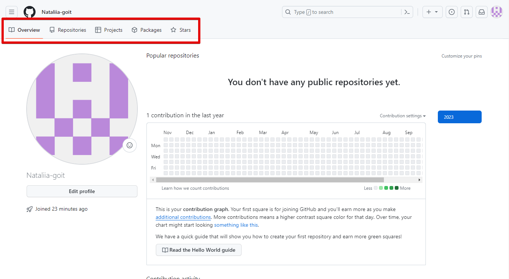
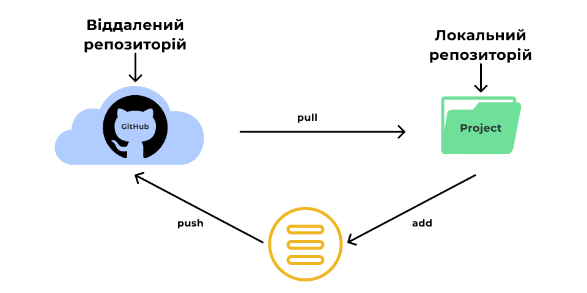
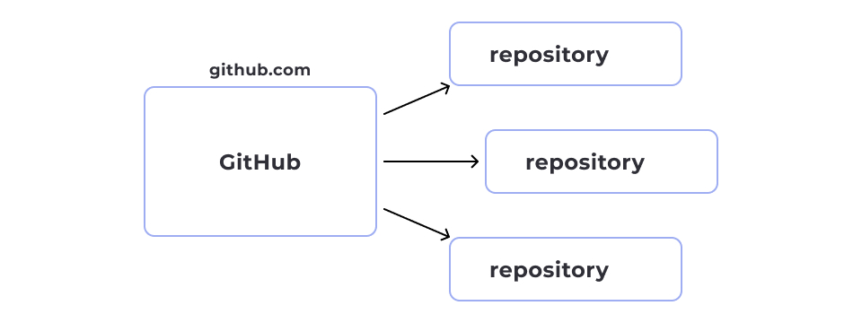
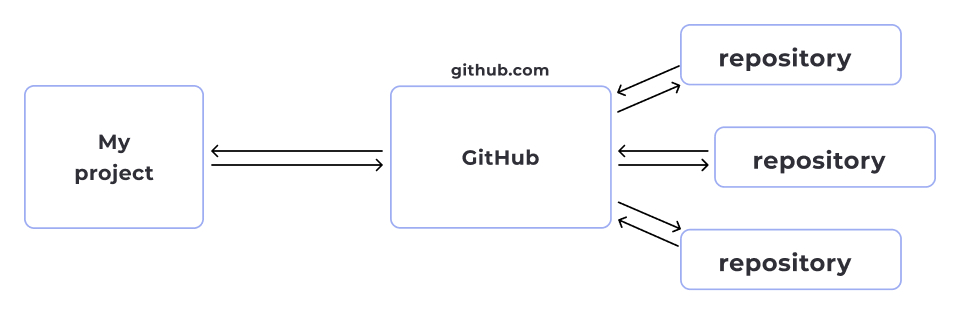

[Головна](../../README.md) / [Системи контролю версій Git і GitHub](../MAIN.md) / [GitHub. Робота з репозиторіями](./MAIN.md)

# Платформа GitHub

Коли розробники працюють із Git, вони часто використовують його для локального управління кодом. Ти вже знаєш, що Git дозволяє відстежувати зміни, створювати гілки та зливати код, але не забезпечує простору для віддаленого зберігання репозиторіїв. Це спричиняє проблему, коли тобі потрібно поділитися кодом з командою або коли ти хочеш зберегти його в безпечному місці в інтернеті.


[GitHub](https://github.com/) приходить на допомогу, пропонуючи вебсервіс для віддаленого зберігання репозиторіїв Git. GitHub не тільки зберігає код в інтернеті, але й надає тобі широкий спектр функціональних можливостей, які полегшують індивідуальну та командну роботу. Сервіс інтегрує управління завданнями, код-рев'ю, системи контролю доступу, а також можливість інтеграції з іншими засобами та платформами.

На сьогоднішній день GitHub є однією з найбільш надійних платформ для розміщення коду. Сервіс використовується мільйонами розробників і великим числом організацій. Щоб забезпечити безпеку користувачів, GitHub пропонує двофакторну аутентифікацію та розширені опції контролю доступу до репозиторіїв.

Відкритий код і спільнота теж є важливими аспектами GitHub. Це не просто сервіс для зберігання коду, а велика платформа для взаємодії з іншими розробниками. Тут ти можеш знайти велику кількість відкритих проєктів, до яких можеш приєднатися або з яких можеш набратися досвіду. З часом твої проєкти можуть рости, і GitHub надає інструменти, які допоможуть тобі масштабувати свою роботу, від малих особистих проєктів до великих комерційних застосунків.

GitHub також надає інструменти і для дизайнерів, менеджерів проєктів та інших учасників розробки, що робить цю платформу універсальним рішенням для команд різних спеціалізацій. Завдяки вебінтерфейсу та наявності додатків для різних операційних систем, GitHub доступний з будь-якого пристрою та ОС, що забезпечує максимальну гнучкість для всіх.

Отже, GitHub доповнює Git, надаючи віддалене сховище для коду, полегшує командну роботу та гарантує надійність і безпеку.

## Реєстрація на Github

Для початку роботи з GitHub тобі потрібно створити безкоштовний обліковий запис на платформі.

1. Перейди на [офіційний вебсайт GitHub](https://github.com/).
1. На головній сторінці знайди кнопку "Sign up" (укр. "Зареєструватися"), натисни на неї та зареєструйся.

> **!** При виборі імені користувача на GitHub краще уникати таких варіантів, як: “Sweet_Bun”, “SexyCoder123”, “code_king”, “Anonymous_Hacker” тощо. Рекрутери зазвичай вивчають профіль кандидата на Github, і такі імена можуть сприйматися як непрофесійні або незрозумілі в контексті розробки програмного забезпечення. Краще вибрати більш серйозне і зрозуміле ім'я, яке стане твоєю візитівкою. Хорошим варіантом може бути твоє справжнє ім’я. Якщо воно вже зайняте, то ти можеш додати до нього додаткові символи. Наприклад, taras_shevchenko456.

Нижче ти побачиш демовідео, де показаний процес реєстрації нового користувача на GitHub.

<video  width="720" height="404" controls>
    <source src="https://goitlmsstorage.b-cdn.net/5b1d9ddf-f4d9-416b-81cf-8c485686a8e8create-accont-github.mp4" type="video/mp4">
</video>

Після реєстрації ти можеш використовувати GitHub для зберігання та управління своїми проєктами.

Щоб мати швидкий доступ, додай GitHub у закладки свого браузера — це спростить тобі часте використання цього сервісу.

## Початковий огляд інтерфейсу профілю GitHub

Після реєстрації на GitHub можна більш детально розібратися з його інтерфейсом.

У верхній частині твого профілю є навігаційна панель.

Давай розглянемо, з чого вона складається.



- **Overview** (укр. **Огляд**). У розділі “Overview” ти побачиш коротку статистику твоєї активності, список репозиторіїв, у яких ти активний/-а, а також можливість переглянути й редагувати свій README файл, який є візитною карткою твого профілю.
- **Repositories** (укр. **Репозиторії**). Тут міститься перелік усіх твоїх власних репозиторіїв, включаючи ті, що є приватними чи належать організаціям.
- **Projects** (укр. **Проєкти**). Тут ти можеш створювати декілька проєктів, керувати задачами, додавати колонки для організації роботи тощо.
- **Packages** (укр. **Пакети**). Тут знаходяться всі пакети, які були опубліковані тобою або до яких у тебе є доступ.
- **Stars** (укр. **Зірки**). Це репозиторії (власні і не власні), які бути позначені тобою як улюблені. Ця функція допомагає швидко знайти цікаві для тебе проєкти.

Зрозуміло, що для ефективної роботи в GitHub необхідно ознайомитися з різними аспектами інтерфейсу. Кожна секція має свою унікальну функціональність, яка може значно полегшити процес розробки і співпраці. Але для початкового ознайомлення з GitHub цього тобі буде достатньо. Більш глибоко розбирати його інтерфейс ти будеш далі.

## Налаштування профілю на GitHub

Тепер ти можеш приступити до налаштування твого профілю на GitHub.

Для цього:

- Клікни у правому верхньому куті на автоматично згенерований аватар твого профілю
- Вибери пункт “Settings” (укр. “Налаштування“). Тебе автоматично перекине на сторінку налаштувань твого профілю.

На сторінці налаштувань GitHub зліва розташована панель навігації, яка допоможе тобі легко перемикатися між різними параметрами.

<video  width="720" height="404" controls>
    <source src="https://goitlmsstorage.b-cdn.net/a91aad30-35ff-4409-88ea-d1755f80d556settings-github.mp4" type="video/mp4">
</video>

Тож давай розглянемо деякі з них, які тобі будуть потрібні для початку.

### Public profile

Тут ти можеш налаштувати аватар свого профілю, ім’я, яке будуть бачити відвідувачі твого профілю, емейл для контактів, короткий опис про себе тощо.

За бажанням ти можеш змінити автоматично згенерований аватар на свій.

Для цього:

- натисни на кнопку “Edit” біля великого аватара праворуч
- обери пункт “Upload a photo”
- вкажи шлях до файлу із зображенням
- обріж та спозиціонуй фото за потреби
- натисни “Set new profile picture”

<video  width="720" height="404" controls>
    <source src="https://goitlmsstorage.b-cdn.net/731d1b21-b1d3-4633-ae34-8c1da9703de7set-avatar.mp4" type="video/mp4">
</video>

Рекрутери часто дивляться на ваш GitHub, щоб оцінити активність. Якщо у вас немає "зелених квадратиків" у Contributions Graph, може здатися, що ви нічого не робите. Але це не завжди правда!

GitHub за замовчуванням не показує активність у приватних репозиторіях. Якщо ви працюєте над кодом у приватному репозиторії, але ця опція вимкнена, ваш профіль виглядає порожнім.

Що зробити?

1. Перейдіть у Settings → Profile.
1. У розділі "Public profile" увімкніть "Include private contributions on my profile".

Це допоможе показати вашу реальну активність, навіть якщо ви працюєте в приватних репозиторіях! Ось відео-інструкція як це зробити у налаштуваннях профілю.

<video  width="720" height="404" controls>
    <source src="https://goitlmsstorage.b-cdn.net/12dfde33-7311-496a-8afc-a88246989dceInclude%20private%20contributions%20on%20my%20profile.mp4" type="video/mp4">
</video>

### Repositories

Тут можна переглянути всі власні репозиторії (проєкти), відфільтрувати їх за типами, мовами, відсортувати або створити новий. Більш детально ти будеш це вивчати трохи пізніше.

Поки що тут немає жодного репозиторію, але незабаром їх тут буде багато.

<video  width="720" height="404" controls>
    <source src="https://goitlmsstorage.b-cdn.net/e34afd3e-8140-439d-ad27-680fc0076020interface-github-repository.mp4" type="video/mp4">
</video>

## Налаштування SSH ключа

На даний момент ти маєш можливість увійти на платформу GitHub, використовуючи свій логін та пароль, і працювати з проєктами на Git через безпечне з'єднання `https://`. Втім, використання логіна та пароля може бути не завжди зручним і не найбезпечнішим способом авторизації. І тут на допомогу приходить SSH-ключ.

### Що таке SSH-ключ і для чого він потрібен?

SSH-ключ — це набір криптографічних даних, що використовуються для безпечного з'єднання з віддаленим сервером. У контексті GitHub, SSH-ключі забезпечують безпечну та зручну взаємодію з твоїми проєктами, скасовуючи необхідність постійно вводити логін і пароль.

### Генерація SSH-ключа

Переглянь відео, прочитай текстові інструкції і згенеруй свій SSH-ключ.

<video  width="720" height="404" controls>
    <source src="https://goitlmsstorage.b-cdn.net/a691eb2a-1e19-462c-ac49-d8720f91fd7assh-key-generation1-with-logo-goit1.mp4" type="video/mp4">
</video>

1) Відкрий термінал (наприклад, Git Bash) на своєму комп'ютері та виконай команду, зазначену нижче. Замість `your_email@example.com` треба вказати свій емейл, під яким у тебе зареєстрований акаунт на GitHub:

```bash
ssh-keygen -t rsa -b 4096 -C "your_email@example.com"
```

> **!** Зверни увагу, що комбінації `ctrl`+`v`/`Command (⌘)` + `v` можуть не працювати, тому вставляй скопійований текст за допомогою правої клавіші миші, як це показано у відео.

Ця команда створить новий SSH-ключ, використовуючи зазначену електронну пошту як мітку.

2) Після цього тобі буде запропоновано вказати місце збереження ключа. Можна лишити запропонований шлях (рекомендовано) або змінити його. Натисни клавішу `Enter`, щоб підтвердити адресу.

3) Потім у терміналі буде запропоновано ввести кодову фразу (passphrase), що буде аналогом твого пароля до SSH-ключа, яку тобі **потрібно буде щоразу вводити при роботі з GitHub**. Цю фразу можна не писати і лишити порожньою. Підтвердь фразу (порожню чи ні), натиснувши на клавішу `Enter`.

4) Повтори кодову фразу (passphrase) для запобігання одруківок. Підтвердь фразу, натиснувши на клавішу `Enter`.

### Додавання SSH-ключа до ssh-agent

1) Запусти `ssh-agent` у фоновому режимі командою:

```bash
eval "$(ssh-agent -s)"
```

2) Додай твій SSH-ключ до `ssh-agent` командою `ssh-add`:

```bash
# Для користувачiв Windows

ssh-add ~/.ssh/id_rsa 

# Для користувачiв macOS. Одночасно зберігає парольну фразу у Keychain

ssh-add --apple-use-keychain ~/.ssh/id_rsa 
```

> **!** Зверни увагу, що шлях до SSH-ключа `~/.ssh/id_rsa` треба буде коригувати в усіх командах на свій, якщо його було змінено під час генерації SSH-ключа у п.2 кроку **“Генерація SSH-ключа”**.

<video  width="720" height="404" controls>
    <source src="https://goitlmsstorage.b-cdn.net/a0f333d3-4abd-4b17-8a2c-cf1e29d910a3ssh-key-generation1-with-logo-goit2.mp4" type="video/mp4">
</video>

Щоб побачити доданий SSH-ключ, виконай команду `cat` зі шляхом до місця, де його було збережено. Ця команда буде виглядати ось так:

```bash
cat ~/.ssh/id_rsa.pub
```

<video  width="720" height="404" controls>
    <source src="https://goitlmsstorage.b-cdn.net/72098886-10aa-4643-81b4-2d0d65a4ae22add-ssh-key-to-github-with-logo-goit%20%281%29.mp4" type="video/mp4">
</video>

### Додавання SSH-ключа до твого GitHub акаунту

1. Скопіюй вміст SSH-ключа. Це можна зробити під час перегляду його вмісту за допомогою команди вище (`cat ~/.ssh/id_rsa.pub`) і клавіш `ctrl+c` (для Windows) або `Cmd+c` (для macOS).
1. Перейди в [налаштування SSH та GPG ключів](https://github.com/settings/keys) на GitHub.
1. Натисни на кнопку "New SSH key", встав скопійований у п.1 ключ, дай йому назву і натисни "Add SSH key".

<video  width="720" height="404" controls>
    <source src="https://goitlmsstorage.b-cdn.net/748671c1-4a06-4e98-84c8-cb22bf00ad35add-ssh-key-to-github-with-logo-goit.mp4" type="video/mp4">
</video>

> **!** До одного GitHub акаунту можна підключити декілька SSH-ключів. Тому якщо ти працюєш із декількох пристроїв, то додай у налаштуваннях GitHub стільки SSH-ключів, скільки тобі потрібно. В подальшому ти завжди можеш видалити зайвий SSH-ключ у налаштуваннях.

Тепер, із доданим SSH-ключем, ти зможеш працювати з GitHub більш безпечно і зручно. SSH-ключ вирішує проблему необхідності постійного введення логіна та пароля, забезпечуючи швидке та безпечне з'єднання з твоїми проєктами на GitHub.

## Віддалені та локальні репозиторії

Репозиторій — це цифрова "скриня" для зберігання коду та інших файлів, які стосуються проєкту. Це також потужний інструмент для управління версіями коду, співпраці з іншими розробниками та документації. Репозиторій допомагає вирішити ряд проблем, що можуть виникнути під час розробки: від трекінгу, хто, що та коли змінював, до забезпечення ефективної командної роботи.



### Віддалені репозиторії (remote repository)

Спершу розглянемо **віддалені (remote) репозиторії** на платформі, наприклад, на GitHub. Це сховище живе на віддаленому сервері і доступне для всіх, хто має відповідний доступ до нього. Однією з ключових переваг віддалених репозиторіїв є можливість колаборації. Багато людей можуть працювати над одним проєктом, не заважаючи один одному, оскільки кожен має доступ до останніх версій файлів. Або, наприклад, ти можеш показати свій код на віддаленому репозиторії ментору, щоб він оцінив його якість і надав рекомендації за потреби.



### Локальні репозиторії (locale repository)

Тепер перейдемо до **локальних репозиторіїв**. Коли ти працюєш над проєктом, тобі не завжди зручно або можливо постійно бути онлайн, або ти можеш хотіти експериментувати з кодом, не ризикуючи "поламати" щось у віддаленому репозиторії. Тут на допомогу приходить локальний репозиторій — це копія твого віддаленого репозиторію, яка знаходиться прямо на твоєму комп'ютері. Ти можеш вносити всі зміни, які хочеш, з комфортом працювати в офлайн-режимі, а потім синхронізувати зміни з віддаленим репозиторієм. Це надає тобі свободу та гнучкість, а також можливість безпечно експериментувати, не впливаючи на роботу команди.



Отже, поєднання віддалених і локальних репозиторіїв дає тобі найкраще з обох світів. Віддалений репозиторій слугує централізованим місцем для зберігання, доступу й управління кодом, де всі члени команди можуть працювати разом. Локальний репозиторій дозволяє тобі працювати незалежно, ефективно й безпечно, надаючи гнучкість для експериментів і тестування. Обидва типи репозиторіїв доповнюють один одного, створюючи ефективне, безпечне й динамічне робоче середовище.

## Створення репозиторію на GitHub

Давай розглянемо послідовність твоїх дій для створення нового репозиторію на GitHub.

### Щоб створити новий репозиторій:

- на сайті GitHub вгорі справа натисни на кнопку "+", щоб відкрити випадаюче меню. Вибери пункт “New repository” (укр. "Створити репозиторій");
- в обов’язкове поле “Repository name” введи назву свого репозиторію, наприклад, `goit-hw-01`;
- у не обов’язкове поле “Description” ти можеш додати короткий опис до репозиторію. Це допоможе іншим розробникам зрозуміти, про що твій проєкт;
- також ти можеш вибрати, чи буде твій репозиторій публічний (Public), чи приватний (Private). Приватні репозиторії будеш бачити тільки ти. Якщо ти хочеш ділитись своїм репозиторієм із кимось (наприклад, щоб його бачив ментор), то твій репозиторій обов’язково має бути публічним;
- рекомендовано в полі "Initialize this repository with:" поставити галочку на чекбокс "Add a README file". Це автоматично додасть у репозиторій файл, який можна наповнити інформацією про проєкт;
- у полі “Add .gitignore” рекомендовано обрати зі списку пункт `Node`. Частою помилкою новачка є обрання пункту `None` замість `Node`. Тут уважно!
- натисни кнопку "Create repository", і готово!

<video  width="720" height="404" controls>
    <source src="https://goitlmsstorage.b-cdn.net/2acf8ada-7f50-45e0-92b0-a0c8c7ca8105create-repository%20%281%29.mp4" type="video/mp4">
</video>

Вітаю тебе зі створенням твого першого репозиторію на GitHub!

Тепер у тебе є власний осередок для коду, де можна ефективно управляти розробкою, взаємодіяти з командою та навіть зберігати корисну документацію. З цього моменту твій процес розробки стане набагато організованішим і безпечнішим.

## Клонування віддаленого репозиторію


Клонування віддаленого репозиторію — це процес створення локальної копії віддаленого репозиторію на своєму комп'ютері.

Але для чого це потрібно?

Уяви, що ти хочеш працювати над проєктом, який знаходиться на GitHub. Ти не можеш просто вносити зміни з нальоту в існуючий код на GitHub без деякої організації, бо тоді можуть виникнути конфлікти, помилки та інші проблеми. Тобі потрібне місце, де ти можеш експериментувати, робити зміни, тестувати код, і все це не впливає на основний репозиторій проєкту до того моменту, поки ти не вирішиш, що зміни готові до публікації.

Отже, клонуванням ти отримуєш свою копію проєкту, над якою можеш працювати без ризику завдати шкоди основному коду. Це дає можливість вільно працювати над задачами, вносити зміни, додавати нові функції або виправляти помилки.

Для **клонування репозиторію** тобі потрібно:

1. Скопіювати на GitHub URL віддаленого репозиторію, який ти хочеш склонувати.
1. Перейти в директорію, де будуть зберігатися всі твої проєкти, наприклад у папку `projects`, та запустити в ній свій термінал.
1. У терміналі ввести команду `git clone` і додати в її кінець URL віддаленого репозиторію:

```bash
git clone <repo-url>
```

Наприклад, це може виглядати так:

```bash
git clone https://github.com/Nataliia-goit/goit-hw-01.git
```

<video  width="720" height="404" controls>
    <source src="https://goitlmsstorage.b-cdn.net/0ad45cad-dc4c-45d2-9a8c-568f1a4ff8b2git-clone.mp4" type="video/mp4">
</video>

За замовчуванням папка зі склонованим локальним репозиторієм буде мати таку саму назву, як і у віддаленого. Але ти можеш це поміняти.

Для цього в команді для клонування тобі потрібно в кінці через пробіл додати нову назву для папки:

```bash
git clone <repo-url> <local-name>
```

Наприклад:

```bash
git clone https://github.com/Nataliia-goit/goit-hw-01.git my-hw-01
```

<video  width="720" height="404" controls>
    <source src="https://goitlmsstorage.b-cdn.net/4abe2d0e-7aba-4d2e-a5ca-f7c082c99a10git-clone-rename.mp4" type="video/mp4">
</video>

Після виконання цієї команди на твоєму комп'ютері у вказаному каталозі з'явиться папка з назвою проєкту, де буде локальна копія всіх файлів проєкту, і ти можеш приступити до роботи.

Під час клонування Git автоматично налаштовує віддалений репозиторій таким чином, щоб ти міг/могла синхронізувати свою локальну копію з віддаленим репозиторієм (утворює зв'язок між ними).

Клонування — це перший крок у роботі над віддаленими проєктами, який дозволяє тобі безпечно й продуктивно працювати над кодом, використовуючи найкращі практики контролю версій та колаборації в команді.

## Відкриваємо проєкт у VSCode через термінал

Репозиторій склоновано, отже, тепер тобі потрібно відкрити проєкт у Visual Studio Code (VSCode). Це зручно робити через термінал, особливо якщо ти вже звик/звикла працювати в терміналі.

Для цього:

- Переконайся, що VSCode встановлено на твоєму комп’ютері. Це дозволить тобі запускати VSCode прямо з терміналу, використовуючи команду `code`.
- У терміналі перейди до директорії (папки) твого проєкту, використовуючи команду `cd`. Якщо ти вже в директорії проєкту (запускав/-ла термінал з відповідної папки), то пропускай цей крок.
- Введи команду `code` з крапкою через пробіл:

```bash
code .
```

Крапка означає "поточна директорія", і VSCode відкриє твій проєкт у поточній директорії.

<video  width="720" height="404" controls>
    <source src="https://goitlmsstorage.b-cdn.net/6f9b1afa-e0e9-4c8c-adc6-b6120b025560open-vscode-with-terminal-with-logo-goit.mp4" type="video/mp4">
</video>

Якщо ж ти хочеш відкрити проєкт, знаючи повний шлях до нього, ти можеш використати команду `code` зі шляхом до проєкту, ось так:

```bash
code ~/шлях/до/твоєї/директорії
```

Введи цю команду, і VSCode відкриє твій проєкт.

<video  width="720" height="404" controls>
    <source src="https://goitlmsstorage.b-cdn.net/7af2cee7-8a1e-40a0-b8b4-13f075a91587open-vscode-terminal-path-with-logo-goit.mp4" type="video/mp4">
</video>

## Відкриваємо проєкт у VSCode

Також ти можеш відкрити проєкт напряму у VSCode.

Для цього тобі потрібно:

- вибрати в меню `File > Open Folder` (укр. `Файл > Відкрити папку`)
- відкрити діалогове вікно і перейти до папки, яка містить твій проєкт
- вибрати папку з проєктом і натиснути “Open” (укр. “Відкрити”)

<video  width="720" height="404" controls>
    <source src="https://goitlmsstorage.b-cdn.net/2362d62a-7866-43b9-9132-484fc59225bcopen-project-in-vscode-with-logo-goit.mp4" type="video/mp4">
</video>

Після відкриття проєкту ти побачиш структуру папок твого проєкту в бічній панелі зліва. Тепер ти можеш відкривати файли для редагування, запускати термінал і використовувати інші інструменти, які надає VSCode для розробки твого проєкту.

< [Система контролю версій](./01%20Система%20контролю%20версій.md) | [Робота з локальним репозиторієм](./03%20Робота%20з%20локальним%20репозиторієм.md) >