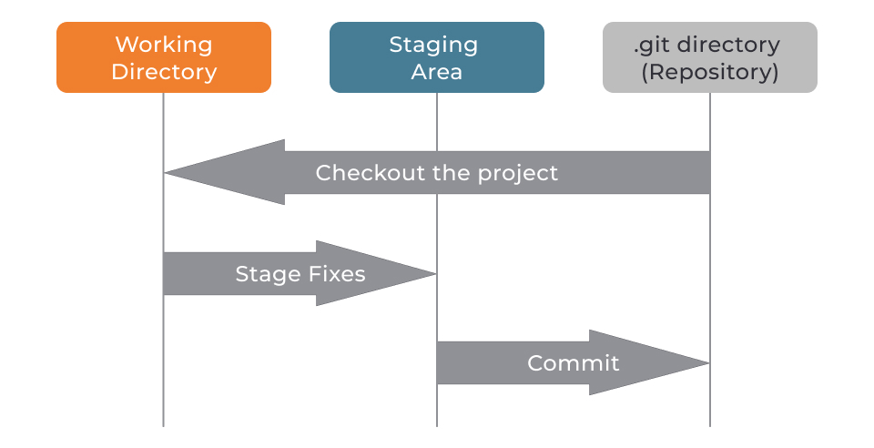
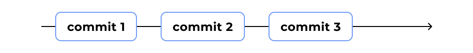

[Головна](../../README.md) / [Системи контролю версій Git і GitHub](../MAIN.md) / [GitHub. Робота з репозиторіями](./MAIN.md)

# Робота з локальним репозиторієм

### Створення локального репозиторію

Тобі вже відомо, як створити репозиторій на GitHub та клонувати його на свій комп'ютер. Однак є випадки, коли робота розпочинається на локальному рівні, і лише пізніше виникає потреба зв'язати локальний репозиторій з віддаленим. Розглянемо процес створення локального репозиторію та його подальшого з'єднання з віддаленим репозиторієм на GitHub.

Уявімо собі, що ти плануєш свій рік, робиш список покупок тощо. Для цього ти створив/-ла кілька текстових файлів на комп’ютері. Якщо ти хочеш зберігати історію змін, ділитися цими даними з друзями або колегами, або працювати над цими файлами з різних пристроїв, тобі знадобиться система контролю версій.

1) Створи папку для свого репозиторію, наприклад, `my-notes`, у яку вклади всі необхідні файли:
    - `plans.txt` — список планів на рік
    - `shopping_list.txt` — список покупок
2) Відкритий з цієї папки термінал
3) Введи команду `git init`, щоб ініціалізувати (створити) Git-репозиторій

```bash
git init
```

У папці з’явиться прихована папка `.git`.

<video  width="720" height="404" controls>
    <source src="https://goitlmsstorage.b-cdn.net/76faa58e-b17e-4499-a54c-24e9cd3377cfgit-init.mp4" type="video/mp4">
</video>

> **!** Зверни увагу! Якщо у тебе на комп’ютері не увімкнена можливість бачити приховані папки, то ти її не побачиш.

Користувачі **macOs** можуть увімкнути опцію бачити скриті папки і файли комбінацією клавіш `Shift`+`Command`+`.`

Користувачам `Windows` потрібно:

1. Відкрити провідник (Explorer)
1. Натиснути на `View` (укр. `Перегляд`)
1. Обрати `Show` (укр. `Показати` )
1. Поставити галочку навпроти `Hidden items` (укр. `Сховані елементи`)

<video  width="720" height="404" controls>
    <source src="https://goitlmsstorage.b-cdn.net/306ffd06-0765-44f4-84a1-9c0f006a440ashow-hidden-folders.mp4" type="video/mp4">
</video>

### Що таке папка `.git`?

Папка `.git` — це мозок твого репозиторію, де зберігається вся необхідна інформація для управління версіями. Вона містить об’єкти файлів, версії, коміти, гілки та інше.

Будь-яке втручання у вміст папки `.git` або її розташування може зіпсувати репозиторій, адже всі зміни повинні виконуватися тільки через спеціальні команди Git.

## Прив’язка локального репозиторію до віддаленого на GitHub

Після створення локального репозиторію за допомогою команди `git init` ти можеш прив’язати свій локальний репозиторій до віддаленого на GitHub.

Щоб **створити віддалений репозиторій**:

- на сайті GitHub вгорі справа натисни на кнопку `+`, щоб відкрити випадаюче меню. Вибери пункт `New repository` (укр. `Створити репозиторій`);
- в обов’язкове поле `Repository name` введи назву твого репозиторію, наприклад, `goit-hw-01`;
- у не обов’язкове поле `Description` ти можеш додати короткий опис до репозиторію. Це допоможе іншим розробникам зрозуміти, про що твій проєкт;
- також ти можеш вибрати, чи буде твій репозиторій `публічний` (Public), чи `приватний` (Private). `Приватні` репозиторії будеш бачити тільки ти. Якщо ти хочеш ділитись своїм репозиторієм з кимось (наприклад, щоб його бачив ментор), то твій репозиторій обов’язково має бути `публічним`;
- ініціалізаційні файли, такі як `README`, `.gitignore` або `License`, додавати не потрібно. Твій новий репозиторій має бути абсолютно порожнім;
- натисни кнопку **Create repository**.

Тепер у тебе є новий порожній репозиторій, і треба скопіювати його SSH URL (без налаштованого SSH-ключа це буде просто URL), який ти будеш використовувати для з'єднання з локальним репозиторієм. Зазвичай це буде щось на кшталт:

```
git@github.com:username/repository.git // з налаштованим SSH-ключем
// або
<https://github.com/username/repository.git> // без налаштованого SSH-ключа
```

Нижче відео створення нового порожнього репозиторію в акаунті з підключеним SSH-ключем.

<video  width="720" height="404" controls>
    <source src="https://goitlmsstorage.b-cdn.net/a2b3477e-127e-4634-bc94-f813571c22fecreate-empty-repository.mp4" type="video/mp4">
</video>

Щоб прив’язати локальний репозиторій до **віддаленого**:

- Відкрий термінал у папці твого локального репозиторію.
- Виконай команду `git remote add origin SSH-URL` для прив'язки твого локального репозиторію до GitHub, де SSH-URL — це той шлях, що було скопійовано в попередньому кроці, наприклад:

```bash
git remote add origin git@github.com:Nataliia-goit/remote_repository.git
```

Тут `origin` — це стандартне ім'я, яке Git використовує для позначення основного віддаленого репозиторію.

<video  width="720" height="404" controls>
    <source src="https://goitlmsstorage.b-cdn.net/46b2e0d1-3937-4b23-96db-4b5416e99d84git-remote-add.mp4" type="video/mp4">
</video>

Щоб **перевірити, до якого віддаленого репозиторію прив'язаний твій локальний**, використовуй у терміналі команду

```bash
git remote -v
```

Ця команда виведе список налаштованих віддалених репозиторіїв та їх URL-адреси. Тобі будуть показані URL для зчитування (fetch) та пушу (push). Це дозволить зрозуміти, які віддалені репозиторії використовуються для отримання змін та які для відправлення змін. У більшості випадків вони в тебе будуть збігатися.

<video  width="720" height="404" controls>
    <source src="https://goitlmsstorage.b-cdn.net/725d2302-f590-480e-a7de-03b40451db68git-remote-version.mp4" type="video/mp4">
</video>

Якщо було допущено помилку під час прив’язки до віддаленого репозиторію, то це можна виправити, переприв’язавши його.

Для цього використовуй команду `git remote set-url`, наприклад:

```bash
git remote set-url origin git@github.com:Nataliia-goit/remote_repository.git
```

Ця команда змінить SSH-URL на новий.

<video  width="720" height="404" controls>
    <source src="https://goitlmsstorage.b-cdn.net/7287f3a8-523b-4c25-97c5-12790d082724git-remote-set-url.mp4" type="video/mp4">
</video>

## Структура git-проєкту

Розуміння основної структури Git-проєкту допоможе тобі впевнено працювати над його кодовою базою.

Основні компоненти структури Git-проєкту включають:

- робочий каталог (working directory)
- проміжну область (staging area)
- .git директорію (repository)



### Робочий каталог (Working Directory)

Уяви, що робочий каталог — це папка на твоєму комп'ютері, де ти тримаєш усі матеріали для свого проєкту. Це можуть бути текстові файли, зображення, програмний код тощо. Коли ти використовуєш систему контролю версій Git і клонуєш репозиторій, Git копіює всі файли проєкту з інтернету на твій комп'ютер у цю папку. Тепер ти можеш з легкістю змінювати ці файли, додавати нові або видаляти непотрібні. До того моменту, як буде вирішено додати ці зміни до Git, вони залишаються просто змінами на твоєму комп'ютері в цій робочій папці, про які Git нічого не знає.

### Проміжна область (Staging Area)

Проміжна область (або індекс) — область, куди розробники можуть додавати зміни, які будуть включені в наступний commit. Це може бути новий файл, зміна існуючого файлу або видалення тощо. За допомогою відповідної команди відбувається додавання змін з робочого каталогу до проміжної області. Це дає розробникам гнучкість визначати, які саме зміни мають бути закомічені для подальшої відправки до віддаленого репозиторію, дозволяючи створювати логічно структуровані коміти.

### .git директорія (Repository)

.git директорія є серцем репозиторію Git. Вона зберігає всю необхідну інформацію для проєкту й управління версіями: відстежувані файли, гілки, теги, коміти, конфігурацію тощо. Коли ти виконуєш коміт, Git зберігає ці зміни у .git директорії. Далі за допомогою відповідної команди беруться дані з проміжної області і зберігаються в новий коміт у .git директорії. Це забезпечує історію змін, яку можна відстежити.

### Взаємодія між компонентами

Коли розробник вносить зміни у робочому каталозі, ці зміни не впливають одразу на віддалений репозиторій. Для цього розробник повинен спочатку додати зміни до проміжної області, а потім закомітити їх до .git директорії. Після цього зміни можуть бути відправлені (push) до віддаленого репозиторію, де інші розробники можуть їх переглянути, завантажити (pull) і продовжити працювати над проєктом.

Розуміння структури Git-проєкту є важливим для ефективної роботи з системою контролю версій. Робочий каталог, проміжна область та .git директорія — це трійця, що забезпечує гнучкість і контроль над процесом розробки, дозволяючи керувати версіями коду та співпрацювати з іншими розробниками без зайвих зусиль. Тому давай розбиратися з усім цим більш детально!

## Статус локального репозиторію

Ти вже маєш локальну версію свого репозиторію. І тут не важливо, була вона склонована чи спочатку створена локально, а потім вже прив’язана до віддаленого репозиторію. Більшість подальших дій буде однаковою для обох варіантів.

Ось кроки, які тобі необхідно виконати на початку, щоб локальну версію твого репозиторію перетворити на повноцінний проєкт, керований системою контролю версій Git.

### Перевірка статусу репозиторію

Спершу потрібно переконатися, що всі необхідні файли були додані для відстежування, а зайві проігноровані. Команда `git status` дозволяє побачити поточний стан репозиторію, вона вказує, які файли та папки були змінені, які готові до коміту (індексовані) або ще ні (неіндексовані) та які не відстежуються системою Git:

```bash
git status
```

Оскільки у твоєму репозиторії ще не було внесено ніяких змін, то після команди `git status` ти побачиш повідомлення `nothing to commit, working tree clean`. Це означає, що немає жодних змін для збереження і стан твого локального репозиторію повністю збігається зі станом віддаленого.

<video  width="720" height="404" controls>
    <source src="https://goitlmsstorage.b-cdn.net/9594573d-8958-418c-b3b9-6117a19d9b7bgit-status-precourse.mp4" type="video/mp4">
</video>

## Додавання під контроль версій

Ключовим аспектом роботи з Git є можливість відстежувати зміни у файлах та директоріях. Цей процес відстежування та керування змінами називається "додаванням під контроль версій". Він дозволяє Git розпізнати, які саме елементи робочого каталогу повинні бути враховані при створенні комітів (фіксацій змін). Ось як це працює:

### Вибір файлів і папок для відстеження

Перед тим як Git зможе зберегти зміни (закомітити), йому необхідно знати, за якими файлами та папками слід вести відстеження. Нові файли і папки в робочому каталозі за замовчуванням не відстежуються. Команда `git add` є одним із базових інструментів для додавання змін до наступного коміту. Ось як можна використовувати її для різних сценаріїв:

Додавання певного файлу `plans.txt`:

```bash
git add plans.txt
```

<video  width="720" height="404" controls>
    <source src="https://goitlmsstorage.b-cdn.net/afa24dd7-73db-48da-978c-a5fba22c69c4git-add-file.mp4" type="video/mp4">
</video>

Додавання файлів із певним розширенням (наприклад, усі файли проєкту з розширенням `.txt`):

```bash
git add *.txt
```

<video  width="720" height="404" controls>
    <source src="https://goitlmsstorage.b-cdn.net/9743c589-a51a-47d6-988a-dd523b38ad80git-add-by-types%20%281%29.mp4" type="video/mp4">
</video>

Додавання всіх змін у поточній папці (поточна папка позначається крапкою):

```bash
git add .
```

Додавання всіх файлів у певній папці (шлях до папки `drafts`):

```bash
git add drafts
```

<video  width="720" height="404" controls>
    <source src="https://goitlmsstorage.b-cdn.net/bd293b3f-d0c5-43d7-9cfc-3f6eda5ad02fgit-add-files-in-folder.mp4" type="video/mp4">
</video>

Додавання усіх нових та змінених файлів і прибирання з відстеження видалених. Ця команда діє на весь репозиторій з будь-якого місця в ньому. Якщо в робочому каталозі було зроблено багато різноманітних змін і ти хочеш підготувати їх усі до коміту, `git add -A` ефективно збирає усе разом, заощаджуючи тобі час на додавання кожного зміненого файлу окремо:

```bash
git add -A
// або
git add --all
```

<video  width="720" height="404" controls>
    <source src="https://goitlmsstorage.b-cdn.net/0a84062e-62d9-45d4-854d-108ad7c273f3git-add-all-clear.mp4" type="video/mp4">
</video>

Git відстежує зміни в файлах, але є одна особливість, яка може створити проблеми для користувачів. Git, за замовчуванням, не розрізняє регістр символів у назвах файлів, тому якщо ви зміните назву файла лише зміною регістру букв, Git може не розпізнати ці зміни як варте уваги.

Допустимо, у тебе є файл `app.js` і ти хочеш перейменувати його на `App.js`. Якщо ти просто його переіменуєш з `app.js` на `App.js`, то це може не привести до змін у репозиторії.

Ось кілька кроків, які можна виконати, щоб забезпечити відстеження цих змін:

1. Перейменуй файл `app.js`, змінивши більше, ніж регістр літер, наприклад, спочатку на проміжну назву `temp.js` командою `git mv`

```bash
git mv app.js temp.js
```

2. Потім переіменуй файл з проміжної назви `temp.js` на бажану, з відповідним регістром `App.js`

```bash
git mv temp.js App.js
```

Тепер Git зможе відстежити зміну, оскільки було змінено повну назву файла. Після цих команд ти можеш далі працювати зі змінами коду і ділитись ними з іншими.

## Прибирання з-під контролю версій

У роботі з Git можуть виникати ситуації, коли файл випадково додали до індексу (staging area), але його не повинно там бути. Наприклад, це може бути файл із приватною інформацією або дуже великий файл, такі файли не бажано зберігати в репозиторії. У таких випадках потрібно вилучити файл з індексу до створення коміту.

Припустимо, у тебе є файл `my-passwords.txt`, який було випадково додано до індексу. Щоб виправити цю ситуацію, тобі потрібно перевірити статус репозиторію командою `git status` для підтвердження, що файл знаходиться в індексі.

- Якщо ти хочеш, щоб зміни файлу `my-passwords.txt` ніколи не потрапляли до комітів і вилучити його з індексу назавжди, то це можна зробити за допомогою команди `git rm --cached <file>`:

```bash
git rm --cached my-passwords.txt
```

Файл залишиться у твоєму робочому каталозі, але буде вилучений з індексу і зміни в ньому не будуть більше відстежуватися гітом.

<video  width="720" height="404" controls>
    <source src="https://goitlmsstorage.b-cdn.net/f4d41cd4-bd2c-41be-97f5-cc64090c9668git-rm-file.mp4" type="video/mp4">
</video>

- Однак, якщо ти хочеш зберегти зміни у файлі `my-passwords.txt` локально і просто вилучити його з поточного індексу, щоб він не потрапив до наступного коміту, ти можеш скористатися командою `git reset <file>`:

```bash
git reset my-passwords.txt
```

Ця команда вилучить `my-passwords.txt` з індексу, але збереже всі зроблені тобою зміни у файлі. Це корисно, коли ти хочеш зберегти зміни для використання в майбутньому, але не хочеш включати їх до поточного коміту.

<video  width="720" height="404" controls>
    <source src="https://goitlmsstorage.b-cdn.net/64e8b6bc-7815-4842-844c-bada152481fegit-reset-file.mp4" type="video/mp4">
</video>

- Якщо ж ти хочеш скинути стан індексу для всіх файлів до останнього коміту і скасувати всі зміни, які були додані до індексу (staging area), використовуй команду `git reset` без вказання файлу:

```bash
git reset
```

Це поверне індекс до стану останнього коміту, але збереже зміни в робочому каталозі. Це може бути корисним, коли ти хочеш відмовитись від усіх змін, які були індексовані, але не хочеш втрачати роботу, яка ще не готова до коміту.

<video  width="720" height="404" controls>
    <source src="https://goitlmsstorage.b-cdn.net/26bd8842-9ff1-4931-bd83-2da373ab1f15git-reset.mp4" type="video/mp4">
</video>

> **!** Зверни увагу, що існують різні опції для команди `git reset`. Для отримання довідки з повним переліком усіх можливих опцій, використовуй команду `git reset --help`.

Зокрема, `git reset --hard` скине індекс і робочий каталог до стану останнього коміту, **видаляючи всі незбережені зміни**. Це може бути ризикованою операцією, оскільки ти можеш втратити внесені зміни, тому використовуй цю команду з обережністю.

<video  width="720" height="404" controls>
    <source src="https://goitlmsstorage.b-cdn.net/86c9241d-91bd-4551-bd9b-e3d0860d7d94git-reset-hard.mp4" type="video/mp4">
</video>

## Файл .gitignore

Файл `.gitignore` відіграє критичну роль у роботі з системою контролю версій Git. Він використовується для вказівки тих файлів або директорій, зміни в яких повинні ігноруватися гітом. Це можуть бути якісь тимчасові файли, які створюються під час компіляції програми, файли з конфіденційною інформацією, такі як паролі, або великі файли даних, які не потрібно зберігати в репозиторії.

Без `.gitignore` ти ризикуєш засмітити свій репозиторій файлами, які не повинні там бути, і це може призвести до різних проблем, зокрема:

- зайвий обсяг даних у репозиторії;
- конфлікти версій файлів, які не мають бути відстежуваними;
- випадкове викриття конфіденційної інформації.

Можна додавати `.gitignore` під час створення репозиторію на GitHub, обравши для нього у відповідному полі шаблон Node. Або створити його вручну. Для цього слід створити файл з цією назвою в кореневій директорії твого репозиторію.

Ось базові кроки для **створення та використання** `.gitignore`:

1) У кореневій директорії свого репозиторію створи файл із назвою `.gitignore`.
2) Відкрий цей файл у текстовому редакторі або у VSCode.
3) Додай шаблони для файлів і директорій, які ти хочеш ігнорувати. Наприклад:

```
// Ігнорувати всі .txt файли
*.txt

// Ігнорувати конкретний файл
config.json

# Ігнорувати всі файли в певній директорії
drafts/*

# Ігнорувати всі .txt файли, крім plans.txt
*.txt
!plans.txt
```

4) Збережи зміни та закрий файл.
5) Додай `.gitignore` до списку відстежуваних файлів твого репозиторію.

```bash
git add .gitignore
```

Після додавання файлу `.gitignore` до твого репозиторію, Git буде ігнорувати файли та директорії, вказані у цьому файлі, таким чином вони не будуть додані до індексу, не з'являться у твоїх комітах і будуть у VSCode підсвічуватися сірим неактивним кольором.

<video  width="720" height="404" controls>
    <source src="https://goitlmsstorage.b-cdn.net/01101e21-0a8d-4d73-8e17-80e8ab9ed172add-gitignore.mp4" type="video/mp4">
</video>

## Фіксація змін у проєкті

Команда `git commit` — фіксує поточний стан файлів у проєкті. Це схоже на створення контрольного збереження у грі, до якого можна повернутися, якщо щось піде не так. Коли ти робиш commit, Git створює знімок того, як виглядає твій проєкт на цей момент.



Перед тим як використовувати `git commit`, дуже важливо переконатися, що всі необхідні файли були додані до індексу за допомогою `git add`.

До команди `git commit` можна також додати опції. Найпопулярнішим є опція `-m`. Вона дозволяє тобі додати коротке повідомлення прямо в командному рядку, не відкриваючи редактор. Це повідомлення слугує описом для змін, що були зафіксовані, і допомагає зрозуміти, що було зроблено в цьому коміті і чому. Наприклад, команда нижче зробить коміт і опише, що в поточному збереженні суть змін полягає в додаванні нової задачі.

```bash
git commit -m "add a new task"
```

<video  width="720" height="404" controls>
    <source src="https://goitlmsstorage.b-cdn.net/05119234-0dc9-4c92-8eac-b35dc690d768git-commit-precourse.mp4" type="video/mp4">
</video>

**Найкращі практики для повідомлень комітів:**

- пиши їх англійською
твоє повідомлення має чітко відображати, що було змінено
- формулюй повідомлення як наказ, наприклад "Add", "Fix", "Update", замість "Added", "Fixed", "Updated"
- повідомлення коміту має бути лаконічним, але водночас інформативним, щоб за потреби його легко було знайти

Команда `git commit -m ""` є необхідним інструментом у твоїй роботі над проєктом. Вона дозволяє ефективно фіксувати твої зміни для інших розробників (і для тебе) про те, що саме було зроблено. Не забувай про лаконічність та зрозумілість твоїх повідомлень комітів.

## Виправлення крайнього коміту

Уяви, що розробник додав необхідні зміни до індексу (Git їх відстежує) та зробив коміт. А після цього виникла необхідність внести корективи до цього коміту. Часто це трапляється, якщо забули додати певний файл або зробити правку, яку хотіли включити до попереднього коміту. Для цього існує команда `git commit --amend`.

Як зробити виправлення?

- Спочатку внеси необхідні зміни у файли, які ти хочеш включити до коміту, наприклад `README.md`.
- Потім додай ці файли до індексу за допомогою `git add` команди:

```bash
git add -A
```

Тепер використай опцію `--amend` з командою `git commit` для модифікації останнього коміту:

```bash
git commit --amend
```

Це відкриє текстовий редактор з останнім повідомленням коміту, яке ти можеш відредагувати.

- Якщо ти хочеш залишити повідомлення без змін, просто збережи та закрий редактор.
- Якщо ж ти хочеш змінити повідомлення коміту, додай опцію `-m` з новим текстом повідомлення:

```bash
git commit --amend -m "add a new task and item to shopping list"
```

<video  width="720" height="404" controls>
    <source src="https://goitlmsstorage.b-cdn.net/111d441c-c473-4eca-b99f-16bb117f3826git-commit-amend-precourse.mp4" type="video/mp4">
</video>

> **!** Опція `--amend` змінює історію комітів, створюючи новий коміт із новим хешем (ідентифікатором). Це може створити проблеми для спільної роботи, якщо змінений коміт уже був відправлений на віддалений репозиторій і ці зміни витягнув хтось інший. Тому опцію `--amend` варто використовувати тільки для локальних комітів, які ще не були відправлені до віддаленого репозиторію.

## Перегляд історії комітів

`git log` — це команда для перегляду історії комітів у репозиторії Git. Вона не тільки показує історію змін, але й дозволяє фільтрувати вивід за різними критеріями.

Давай розбиратись з цим більш детально.

### Основи git log

Якщо виконати команду `git log` у терміналі, то ти отримаєш список комітів для поточної гілки (за замовчуванням main), відсортований у зворотньому хронологічному порядку.

Типовий вивід міститиме:

- хеш (унікальний ідентифікатор) коміту,
- ім'я автора,
- електронну пошту,
- дату коміту та
- повідомлення коміту. Наприклад:

```bash
commit c242185cf50fa0c490a6915c602aff60889b179d (HEAD -> main)
Author: Nataliia-goit<75252511+Nataliia-goit@users.noreply.github.com>
Date:   Sun Nov 12 17:13:14 2023 +0200

    clear readme

commit cb5fa881b905ceb4ed551e242792d5f844277329 (origin/main, origin/HEAD)
Author: Nataliia-goit <75252511+Nataliia-goit@users.noreply.github.com>
Date:   Sat Nov 11 22:02:22 2023 +0200

    Initial commit
```

<video  width="720" height="404" controls>
    <source src="https://goitlmsstorage.b-cdn.net/60d8829e-8178-4ef4-a5c9-a3cbeb6c4c5agit-log-precourse.mp4" type="video/mp4">
</video>

### Опції команди git log

`git log` має безліч опцій, які роблять її неймовірно гнучкою, давай розглянемо деякі із них:

- кількість комітів.

Команда `git log -n <quantity>` покаже вказану кількість останніх комітів.

Наприклад, ця команда покаже два останні коміти.

```bash
git log -n 2 
```

<video  width="720" height="404" controls>
    <source src="https://goitlmsstorage.b-cdn.net/7fbdce41-6bd3-4f97-9d39-1fed74a9d1e5git-log-n-2.mp4" type="video/mp4">
</video>

- фільтрація за датою.

Команда `git log --since=<times_period>` покаже коміти, створені протягом переданого часу. Наприклад ця команда покаже коміти, які були створені протягом останніх двох тижнів:

```bash
git log --since=2.weeks
```

- фільтрація за автором.

Команда `git log --author="author name"` покаже коміти, зроблені певним автором. Наприклад ця команда покаже коміти, які було створені автором `nataliia`

```bash
git log --author="nataliia"
```

`git log` — незамінний інструмент для розуміння історії репозиторію. Він дозволяє відслідковувати зміни, проводити код-рев'ю та виявляти, коли і ким були внесені зміни. Використання різноманітних опцій команди `git log` значно спрощує навігацію по історії проєкту та управління змінами. Використовуючи `git log` ти зможеш ефективно управляти своїми проєктами та співпрацювати з командою.

## Робота зі стеком змін (Stashing)

Коли ти працюєш над проєктом, іноді виникають ситуації, коли потрібно тимчасово відкласти незавершені зміни, щоб повернутися до них пізніше. Наприклад, тобі може знадобитися переключитися на іншу гілку для вирішення термінової проблеми, але ти не хочеш втратити поточний прогрес. Тут на допомогу приходить спеціальна команда для збереження незавершених змін `git stash`.

### Створення Stash

Щоб тимчасово відкласти зміни і створити стеш, використовуй команду `git stash`. Ця команда зберігає твої незавершені зміни (як відслідковані, так і невідслідковані файли) у спеціальному тимчасовому місці, яке називається "stash", при цьому очищаючи робочий каталог.

```bash
git stash
```

<video  width="720" height="404" controls>
    <source src="https://goitlmsstorage.b-cdn.net/20742941-a3eb-4fad-8b7a-a42fec68f0f5git-stash1.mp4" type="video/mp4">
</video>

Оскільки ти можеш мати декілька стешів, щоб уникнути плутанини, рекомендується додавати коментар при створенні нового стеша. Це можна зробити за допомогою опції `save`, наприклад, ось так:

```bash
git stash save "my-comment"
```

<video  width="720" height="404" controls>
    <source src="https://goitlmsstorage.b-cdn.net/067a0828-1304-4301-ba14-7f695995c469git-stash2.mp4" type="video/mp4">
</video>

### Перегляд списку Stash

Кожен стек (збережені незавершені зміни) зберігається з унікальним ідентифікатором та описом, що дозволяє легко ідентифікувати відкладені зміни командою `git stash list`

```bash
git stash list
```

<video  width="720" height="404" controls>
    <source src="https://goitlmsstorage.b-cdn.net/03a1c655-727e-4bc7-b224-f5eb39baad42git-stash-list2.mp4" type="video/mp4">
</video>

### Застосування Stash

> **!** Щоб застосувати відкладені зміни зі стешу, твій поточний код **обов’язково має бути збережений у вигляді коміту**, в іншому випадку ти отримаєш повідомлення про помилку застосування.
Щоб **застосувати найостанніші відкладені зміни** і **видалити їх із стеку**, використовуй команду `git stash pop`

```bash
git stash pop
```

<video  width="720" height="404" controls>
    <source src="https://goitlmsstorage.b-cdn.net/62027d53-54ed-4636-8c62-fb243b841a20git-stash-pop.mp4" type="video/mp4">
</video>

Якщо ти хочеш застосувати певний stash **без його видалення із стеку**, використовуй команду `git stash apply stash@{<number_stash>}`, де `<number_stash>` — номер stash у списку, наприклад:

```bash
git stash apply stash@{56f4530}
```

<video  width="720" height="404" controls>
    <source src="https://goitlmsstorage.b-cdn.net/70e0f602-10c5-4455-b6e9-db19eb05b7fagit-stash-apply.mp4" type="video/mp4">
</video>

### Видалення Stash

Щоб видалити конкретний stash із списку, використовуй команду `git stash drop stash@{<number_stash>}`, де `<number_stash>` — номер stash у списку, наприклад:

```bash
git stash drop stash@{56f4530}
```

<video  width="720" height="404" controls>
    <source src="https://goitlmsstorage.b-cdn.net/537337b3-6c07-4377-9766-914d5a0eaa87git-stash-drop.mp4" type="video/mp4">
</video>

Для видалення усіх збережених стеків змін, використовуй

```bash
git stash clear
```

> **!** Використовуйте stash як тимчасове рішення. Це не заміна гілкам чи комітам для довгострокового зберігання даних

## Відправлення змін на GitHub

Під час роботи над проєктом ти вносиш зміни тільки в локальну копію репозиторію. Але коли настає час ділитися цими змінами з іншими учасниками проєкту або зберегти їх на GitHub, ти маєш використовувати команду `git push`.

Ця команда "штовхає" (пушить) твої локальні коміти до віддаленого репозиторію, забезпечуючи таким чином синхронізацію даних між локальним і віддаленим репозиторіями.


Команда `git push` — це стандартний спосіб публікації твоїх змін після того, як вони були зафіксовані в локальному репозиторії.

```bash
git push
```

<video  width="720" height="404" controls>
    <source src="https://goitlmsstorage.b-cdn.net/1fb550a8-4036-47a9-808c-a6683f61b5bbgit-push-precourse.mp4" type="video/mp4">
</video>

> **!** Важливо зазначити, що командою `git push` можна відправити на віддалений репозиторій лише ті зміни, які були зафіксовані у комітах.

Якщо ти працюєш з локальною версією новоствореного віддаленого репозиторію, тобто віддалена його версія ще порожня і без жодної гілки, то команда `git push` працювати не буде. Тому спочатку тобі потрібно створити й перейменувати основну гілку. Більш поглиблено про гілки ти дізнаєшся далі, але зараз, щоб у тебе була можливість відправляти коміти до віддаленого репозиторію, тобі потрібно виконати наступні команди:

```bash
git branch -M main      // спочатку перейменовуємо дефолтну гілку master на main

git push -u origin main // потім відправляємо зафіксовані зміни до віддаленого репозиторію у віддалену гілку main
```

Під час пушу на GitHub ти синхронізуєш локальний репозиторій з віддаленим. Тепер стан коду в репозиторії на твоєму комп’ютері і в репозиторії на GitHub однаковий. Далі ми розглянемо, де ці зміни будуть відображатися на GitHub і як їх побачити.

< [Платформа GitHub](./02%20Платформа%20GitHub.md) | >